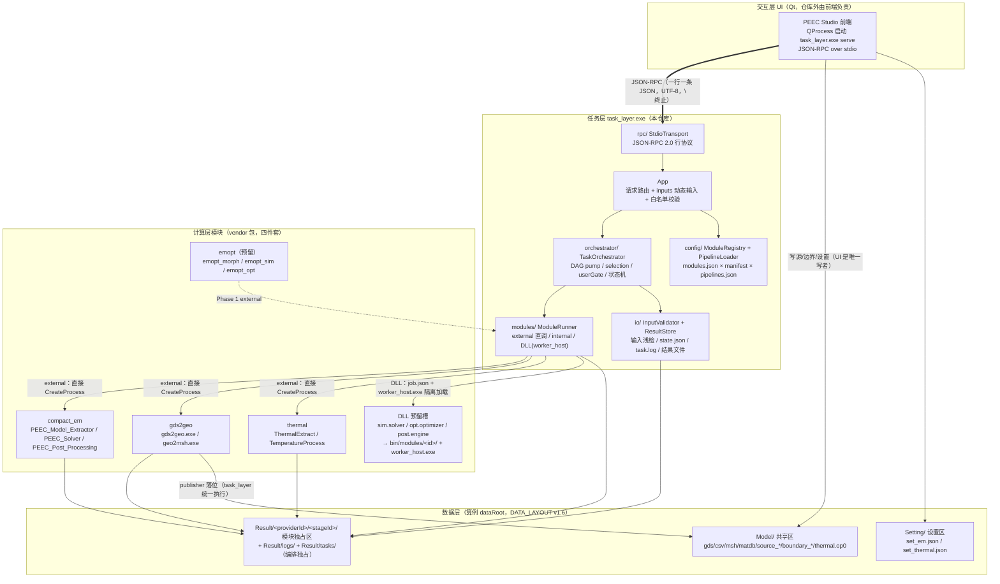
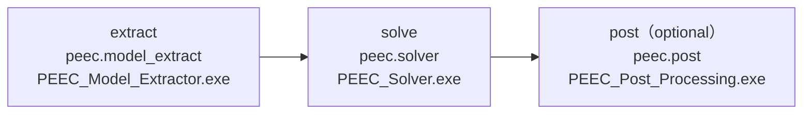
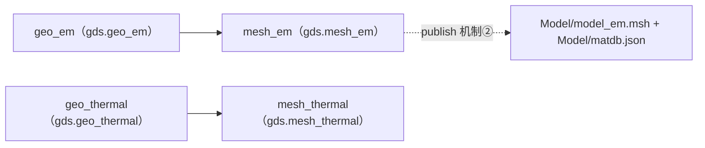

# PEEC_Studio 项目架构设计说明

| 项目 | 内容 |
|---|---|
| 文档版本 | v1.0 |
| 编制日期 | 2026-11-09 |
| 交付基线 | 平台 v2.2（`PEEC_Studio_20261109_v2.2`，37 项白名单） |
| 模块基线 | compact_em v1.3（2026.11.04）/ gds2geo V1.2 r2（GDS2GEO-V1.2-20261107-r2）/ thermal 1.0.7（2026.11.06-native-1.0.7）/ emopt 设计基线 2026-11-04（未入交付） |
| 需求来源 | `docs/` 全部现行文档 + 各模块包契约 + `task_layer/` 源码与配置（清单见 §14.2） |

本文是**综合架构设计说明**：以 `docs/` 为需求源、以仓库现状（代码/配置/模块包）为事实源，
对 PEEC_Studio 平台做一次全方位架构描述。它是新增文档，不取代任何既有规范文档；
与既有文档不一致时，以版本化的规范文档（DATA_LAYOUT / MODULE_MANIFEST_SPEC /
DELIVERY_PACKAGE_SPEC / UI_API 等）为准，并应反馈修订本文。

---

## 目录

1. [项目总览](#1-项目总览)
2. [总体架构：分层与进程模型](#2-总体架构分层与进程模型)
3. [任务层 task_layer 内部架构](#3-任务层-task_layer-内部架构)
4. [UI ↔ 任务层通信协议（JSON-RPC over stdio）](#4-ui--任务层通信协议json-rpc-over-stdio)
5. [配置体系与模块契约](#5-配置体系与模块契约)
6. [数据布局与所有权（DATA_LAYOUT v1.6）](#6-数据布局与所有权data_layout-v16)
7. [计算层模块架构](#7-计算层模块架构)
8. [内置流水线](#8-内置流水线)
9. [错误与状态体系](#9-错误与状态体系)
10. [交付与版本治理](#10-交付与版本治理)
11. [测试与验证基线](#11-测试与验证基线)
12. [当前开放问题](#12-当前开放问题)
13. [演进路线](#13-演进路线)
14. [附录](#14-附录)

---

## 1. 项目总览

### 1.1 定位与范围

PEEC_Studio 是一个 **Windows 平台上的 PEEC 电磁 + 热仿真一体化软件平台**。它以
"UI + 任务层 + 计算模块 + 数据目录约定" 的形态，把以下能力编排为可复用的仿真流水线：

- **电磁**：GDS 版图 → 几何/网格 → PEEC 模型提取 → 频域求解（S 参数）→ 后处理；
- **热**：GDS → 几何/网格 → 热网络提取（SPICE 网表）→ OP0 工况求解 → 温度场后处理；
- **扩展位**：FEM 电磁优化（emopt，设计基线，Phase 1 以外部 EXE 接入）、
  通用求解器/后处理引擎（DLL 预留槽）。

仓库根目录（`E:\code\PEEC_Studio`）：

| 目录/文件 | 角色 |
|---|---|
| `compact_em\` | 计算模块包：PEEC 电磁（3 EXE + manifest + README + ERROR_CODES） |
| `gds2geo\` | 计算模块包：GDS→GEO→MSH（2 EXE + manifest + README + ERROR_CODES） |
| `thermal\` | 计算模块包：热提取与温度后处理（2 EXE + manifest + README + ERROR_CODES） |
| `task_layer\` | 任务层：`task_layer.exe` 源码、`config/`（modules.json / pipelines.json）、UI_API.md、ERROR_CODES.md |
| `tools\gmsh\` | 平台所有的 gmsh 4.11.1（86 MB），供 gds2geo 网格阶段与（预留）emopt 使用 |
| `templates\` | 算例初始值模板（settings 初值 + Model/ 绑定件初值），归平台管理 |
| `dev\cases\` | 开发/验收算例（compact_em\standard、compact_em\two_layer_surface_port、heater_strip、thermal\demo1_4.1、thermal\heater） |
| `docs\` | 需求与规范文档（本文所在目录）：DATA_LAYOUT、MODULE_MANIFEST_SPEC、DELIVERY_PACKAGE_SPEC、MODULE_ONBOARDING、module.manifest.schema.json、plans/、REPACK/、archive/ |

### 1.2 版本基线（2026-11-09，平台 v2.2）

| 组件 | 版本 | 形态 | apiVersion | 要点 |
|---|---|---|---|---|
| task_layer（平台） | v2.2 | MSVC 产线 / MinGW 本地均可构建 | —（协议 schemaVersion 1） | P1/P1.5/P2/P3 全部落地；`dist` = task_layer.exe ~935 KB + Qt6Core.dll 6.8 MB + 3 个 MinGW 运行库 + `config/` + `bin/worker_host.exe` |
| compact_em | v1.3（2026.11.04） | 3 EXE | 3（min 1） | `set_em.json` 为 EM 链唯一 JSON 设置；plot 阶段/plotter EXE 移除；S 参数由前端读 CSV 绘制 |
| gds2geo | V1.2 r2（2026-11-09 集成） | 2 EXE：`gds2geo.exe`（`--target em\|thermal`）、`geo2msh.exe`（同） | 4 | 数据面 4 子目录（em_geo/thermal_geo/em_msh/thermal_msh）；MSH = Delivery API 4 全维（vendor 方言）；publisher 落位改由平台 `publishes` 机制执行 |
| thermal | 1.0.7 | 2 EXE：`ThermalExtract.exe`、`TemperatureProcess.exe` | 7 | source_thermal v2/v3 与 boundary_thermal v1/v2 成对解析；exit 6 = `QS-TH-RUN-LOCKED`；strict OP0 后置检查 |
| emopt | 设计基线（2026-11-04） | 4 EXE（morph/sim/opt/gui） | 未入交付 | 平台接入设计完成（Phase 1 = external），`opt.optimizer` 槽预留 |

### 1.3 总体设计原则

1. **定义与执行正交**：流水线"跑什么"（selection/resume）与"怎么跑"（DAG/并行/闸门）
   相互独立，运行时选择不改静态定义。
2. **不造新引擎**：任务层只做检查、编排、路由、状态与结果管理；所有计算在模块侧
   （独立 EXE，目标是 worker_host 隔离加载的 DLL）。
3. **三层配置所有权**：`module.manifest.json` = 模块真相（vendor 维护）、
   `pipelines.json` 阶段库 = 平台接线真相（平台维护）、pipeline = 组合（平台维护）。
   模块包与平台配置互不携带对方内容。
4. **零 task_layer 适配器代码底线**：模块接入原则上只靠"模块包 + manifest + modules.json
   路由行 + pipelines 接线"；例外须显式登记（现行唯一例外：gds2geo r2 的 `publishes`
   机制②，见 §6.3-D7）。
5. **数据驱动 + 字节级可复现**：所有跨模块交接走 DATA 目录下的命名工件 + ref 路由；
   验收以 SHA-256 字节级基线为准（§11）。
6. **程序/数据分离**：安装目录（EXE、config、tools）只读；算例数据全部位于
   `<dataRoot>/`（Model/Setting/Result），模块不得写非自身目录（§6.10）。

---

## 2. 总体架构：分层与进程模型

### 2.1 四层模型



| 层 | 载体 | 职责 | 不负责 |
|---|---|---|---|
| 交互层 | Qt UI（仓库外） | 算例管理、输入编辑、进度/曲线展示（直读产物）、错误展示 | 调度、路径拼装、模块调用 |
| 任务层 | `task_layer.exe`（serve / run / validate / modules / pipelines 模式） | 输入检查、任务编排（DAG）、模块路由与启动、状态与结果管理、publisher 落位 | 数值计算、绘图 |
| 计算层 | 模块 EXE（迁移期）→ 功能 DLL + `worker_host.exe`（目标形态） | 全部数值计算与工件产出 | 跨模块文件搬移、编排状态 |
| 数据层 | `<dataRoot>/{Model,Setting,Result}` | 跨模块交接的工件与绑定（SHA-256） | — |

### 2.2 进程模型

- **UI → 任务层**：UI 以 `QProcess::start("task_layer.exe", {"serve"})` 启动子进程
  （`SeparateChannels`），stdin/stdout 走 JSON-RPC。退出流程：先发 `shutdown` 等其自行
  退出，超过 10 s 才 kill；UI stdin 关闭时任务层自动退出（活动任务按取消收尾）。
- **任务层 → 模块（迁移期，external）**：任务层对每个阶段直接启动独立 EXE
  （`CreateProcess`，workingDir 默认 `{DATA}`，env 按 modules.json 注入）。
  崩溃/超时/取消按阶段隔离。
- **任务层 → 模块（目标形态，DLL）**：模块以 `bin/modules/<moduleId>/xxx.dll` 交付，
  每 DLL 阶段由**独立** `worker_host.exe` 进程加载（`LoadLibrary`/`SetDllDirectoryW`），
  实现崩溃与内存隔离；job 定义为任务层写入 `Result/tasks/<taskId>/job.<stage>.json`
  的任务 JSON（含参数、路径、层契约）。接口为 C ABI：
  `int qs_peec_module_entry(const char* job_json_path, const char* data_root, const char* log_path)`
  （见 `task_layer/src/modules/module_api.h`，可选 `qs_peec_module_info`）。
- **并发**：单进程**不支持并发任务**（`m_busy` 串行门）；UI 侧要么串行发任务，
  要么多开 task_layer 进程。进程内阶段级并行由 `maxParallel` 控制（现行三条流水线均为 1）。

### 2.3 关键架构决策（摘要）

| 决策 | 理由 |
|---|---|
| UI 与任务层完全解耦（stdio JSON-RPC） | UI 可独立迭代/换壳；任务层可无 UI 运行（CLI + 冒烟脚本）；协议即契约（UI_API.md） |
| 迁移期 external 直调，目标 DLL + worker_host | EXE 独立进程语义天然成立、接入零平台代码；DLL 提供统一入口/层契约/崩溃隔离（§13） |
| 单任务串行 + 阶段级 maxParallel | Compact 依赖 `DATA/.peec-data.lock` 独占句柄；避免数据面竞争；队列/并发池留作扩展点 |
| settings 模板归平台（`templates/`）而非模块包 | 模块包保持"四件套"纯计算身份；设置默认值变更走平台交付说明（2026-11-04 定） |
| gmsh 归平台（`tools/gmsh/`） | 平台统一版本（4.11.1）与路径（`GDS2GEO_GMSH_EXECUTABLE` / 预留 `EMOPT_GMSH_LIBRARY` env 注入） |
| 正式件落位（publisher）由任务层统一执行 | 模块产物留在 `Result/<provider>/` 自由区；`Model//Setting/` 的写者唯一化（D3/D7） |
| `pipelines.json` 只引用模块 id、不含路径 | 路径全部来自 modules.json 路由 × manifest argsTemplate；模块目录更名不牵动流水线（2026-10-28 先例） |

---

## 3. 任务层 task_layer 内部架构

### 3.1 代码结构

源码位于 `task_layer/src/`（Qt6 Core only，不依赖 Widgets；MSVC v143 产线 / MinGW 13.1 本地两条构建线）：

| 模块 | 文件 | 职责 |
|---|---|---|
| 入口 | `main.cpp` | 命令行分发：`serve` / `run` / `validate` / `modules` / `pipelines`；模块根与 `{BIN}` 推导 |
| 主应用 | `App.{h,cpp}`（~42 KB） | RPC 请求路由（10 个 `rpc*` 方法）+ 启动公共逻辑 `startTaskWith`（busy 检查 → 建任务目录 → resolver/store → 编排器）+ `inspectInputs`（输入检查，含 selection）+ `checkAllowedArgs`（overrides 与 gate 输入共用的 manifest 白名单校验）+ `rpcRunModule`（单模块执行：内部构造"单阶段合成流水线"，状态/通知/结果与流水线完全一致） |
| 编排器 | `orchestrator/TaskOrchestrator.{h,cpp}`（~25 KB） | DAG 调度核心：`startTask`（selection 归一 + 预检 + m_pending 建列）、`pump()`（就绪优先 + maxParallel + 防重入）、`isReady`、`propagateBlocked`（依赖失败/跳过传播）、`launchStage`（optional 分支 + userGate 分支）、`cancel`、`provideInput`（P1.5）、`finishTask` |
| 模块注册 | `config/ModuleRegistry.{h,cpp}` + `ModuleManifest.{h,cpp}` | 加载 modules.json v2 路由；在模块根发现并加载各 provider 的 `module.manifest.json`；合成 `ModuleDef`（命令/searchDirs/env/contract/publishes/allowedArgs/errorType…）；`rebindDataRoot`（每任务重展开 args 与契约路径，注入 artifact/publish 覆盖，幂等） |
| 流水线加载 | `config/PipelineLoader.{h,cpp}` | pipelines.json schemaVersion 1/2 加载 + 阶段库（`stages` 库，key=ref）+ `pipelines.local.json` 部署级覆盖（同名 local 赢，任何错误整文件拒载）+ `PathResolver`（路径变量解析） |
| 模块执行 | `modules/ModuleRunner.{h,cpp}`（~17 KB） + `module_api.h` | 三种启动分支：external（直接进程）/ internal（无实体 EXE，如 `internal.handoff` 清理类）/ DLL（job.json + worker_host）；stdout 行回调、退出码归一/透传、outputCheck 浅检、publisher 落位 |
| IO | `io/InputValidator.{h,cpp}` / `ResultStore.{h,cpp}` | 输入浅检（required/optional 文件存在性 + `port.json` 与网格 SHA-256 绑定）；`state.json`/`task.log` 落盘、结果文件清单 |
| 传输层 | `rpc/StdioTransport.{h,cpp}` + `JsonRpc.h` | stdio 行协议、JSON-RPC 2.0 编解码、错误码（-32xxx 段） |
| 宿主 | `worker_host/main.cpp` | DLL 宿主：读 job JSON → 加载 `bin/modules/<id>/` 下 DLL → 调 `qs_peec_module_entry` → 按退出码收尾 |

### 3.2 执行模型（DAG pump）

```
startTask(taskId, pipeline, registry, resolver, dataRoot, overrides, selection)
  ├─ selection 归一（P1：full/stages/resume → 有效阶段集 + 假定完成集 m_assumed）
  ├─ 预检（拒绝级错误：QS-TL-SEL-UNKNOWNSTAGE / QS-TL-SEL-DEP-MISSING，不留任务目录）
  ├─ rebindDataRoot(dataRoot, artifactOverrides, publishOverrides)   # 每任务一次
  ├─ m_pending = 全部阶段；m_assumed 阶段写合成 StageRecord（status=Done, assumed=true,
  │    errorCode=QS-TL-ASSUMED-DONE, outputs=[]；不参与 failed/blocked 统计）
  └─ pump()
       ├─ 存在 WaitingInput 阶段 → 合法停等（return，防悬挂兜底不误杀）
       ├─ 对每个 pending：propagateBlocked（上游 failed→DEP-BLOCKED / skipped→DEP-SKIPPED）
       │    无变化且无 running 且 pending 非空 → 死锁兜底（QS-TL-CFG-DEADLOCK 收尾）
       ├─ isReady（依赖全部 done；optional 阶段入口按当前输入复检：
       │    optionalInputs 缺失 → 主动 skipped（QS-TL-SKIP-NOINPUT））
       └─ launchStage：
             ├─ userGate 未满足 → 置 WaitingInput、留 m_pending、发 task.stage.awaiting、return
             ├─ optional 分支（自身输入缺失 → skipped 不阻断）
             └─ ModuleRunner.launch（external/internal/dll；超时自 launch 起算，
                  等待时间不计入）
       阶段完成（onStageFinished）→ outputCheck → publisher 落位 → 通知 → pump()
```

要点：

- **就绪优先 + 最大并行**：`maxParallel` 限制同时 running 数（现行三链均 1）；
- **防重入**：`launch` 可能同步回调 `stageFinished`（快阶段），`m_pumping` 标志防重入；
- **取消**：`task.cancel` 对 running 阶段发终止，running 收尾为 `QS-TL-CANCEL`，
  后续未启动阶段按依赖传播标记；等待中（WaitingInput）的阶段取消同样 → Skipped/`QS-TL-CANCEL`；
- **P3 修复先例**：编排器值拷贝持有 `PipelineDef`（module.run 的合成流水线是调用方栈上
  临时对象，存指针会在收尾时悬垂，ACCESS_VIOLATION）。

### 3.3 阶段状态机

```
                 ┌──────────────┐
   isReady       │   pending    │  依赖未满足 / 闸门未满足
 ┌──────────────►│              │
 │               └──────┬───────┘
 │                      │ isReady 通过
 │                      ▼
 │               ┌──────────────┐  userGate 未满足
 │               │   running    │◄──────────────┐
 │               └──┬───────┬───┘               │  task.provideInput 满足
 │        成功/失败  │       │                   │
 │                  ▼       ▼            ┌──────┴───────┐
 │             ┌───────┐ ┌────────┐      │  WaitingInput │（序列化 "waiting"，非终态）
 │             │ done  │ │ failed │      └───────────────┘
 │             └───────┘ └────────┘
 │   上游 failed/skipped │ optional 输入缺失 │ 用户取消
 │                       ▼                 ▼
 │                  ┌─────────┐     ┌────────────┐
 │                  │ skipped │     │ cancelled/ │
 │                  └─────────┘     │ skipped(QS- │
 └── resume 复评                    │  TL-CANCEL) │
      （optional 按当前输入）        └────────────┘
   另：notConfigured（模块/路由缺失，配置错误）
```

阶段状态记录于 `state.json`（每阶段：status/errorCode/errorMessage/outputs/assumed/…），
任务级 `state.json` 顶层含 `selection`、`providedInputs` 留痕（§3.4/§3.5）。

### 3.4 执行选择 selection（P1，2026-11-05 起）

`task.run.selection`（仅 JSON-RPC；CLI `run` 始终全链）：

| mode | 语义 |
|---|---|
| `full`（缺省） | 全链（等价旧行为） |
| `stages` | 跑 DAG 子集（按 pipeline 内 stage id 选择）。未选中但被依赖的上游：记**合成 StageRecord**（`status=Done`、`assumed:true`、`errorCode=QS-TL-ASSUMED-DONE`、`outputs=[]`），其产出必须在盘存在（否则 `QS-TL-SEL-DEP-MISSING`，拒绝启动）。假定完成是记账不是错误，不参与 failed/blocked 统计 |
| `resume` | 基于上次任务 `state.json` 续跑：读 `resumeTaskId` 的 state.json（pipeline 须一致，否则 `resume: pipeline mismatch (state is for '<id>')`）；上次 Done 且产出在盘 → assumed（指纹不符 → `QS-TL-DEP-STALE` warning）；Skipped/Failed/Pending 重跑（optional 按当前输入重评估）；生成新 taskId |

规则：

- 未知 stage → `QS-TL-SEL-UNKNOWNSTAGE`（拒绝启动，不留目录）；
- 启动前预检 + 每阶段 launch 前复检（防御式，防运行中盘上变化）；
- `task.started` 通知携带 selection；每个假定阶段各发一条
  `task.stage.finished(assumed:true)`；`task.finished.summary` 追加 `| assumed: ...`；
- `inputs.validate` 带 selection 时只校验**执行入口**（非全链）。

### 3.5 用户闸门 userGate（P1.5，2026-11-05 起）

阶段级可选键 `userGate`，三键按需组合（全缺省 = 无闸门）：

| 键 | 形态 | 语义 |
|---|---|---|
| `waitForFiles` | F1 产出文件 | 列出的 dataRoot 相对路径全部存在才放行。**无文件监听**：UI 写完文件后必须调 `task.provideInput`（values 可为空对象）作为唤醒事件；平台只在收到调用时复检文件 |
| `inputs` | F2 产出 CLI 参数 | `[{name,type,required,description}]`；值过 manifest `allowedArgs` 白名单（与 overrides 同一校验路径），拼 CLI `--name value` 追加，与模板同键覆盖模板默认 |
| `confirm` | F3 纯确认 | 等显式确认 |

运行时语义：

- 未满足 → 阶段状态 `WaitingInput`（序列化名 `"waiting"`，**非终态**）：不发启动、
  留在 `m_pending`、任务保持 busy；发 `task.stage.awaiting {taskId,stageId,name,module,
  gate,missing:{files,confirmed,inputs}}`；
- 新 RPC `task.provideInput {taskId,stageId,values?}`：任务须活动且该阶段处于 waiting，
  否则 `QS-TL-INPUT-NOTWAITING`；支持增量（values 可为空对象）；留痕
  `state.json.providedInputs {stageId:{values,ts,confirmed?}}`；全满足 → 转 Ready，pump 启动；
- **等待不计入模块超时**（超时自 launch 起算）；`task.finished.elapsedMs` 含等待时长（墙钟如实）；
- 等待中可 cancel → Skipped/`QS-TL-CANCEL`；与 selection 正交（gate 阶段可在 selection 子集内）；
- 最大陷阱（已处理）：pump 防悬挂兜底"无 running + pending 非空 + 无传播 → 判死锁"
  会误杀等待阶段；修复 = pump 循环中 `hasWaiting()` 为合法停等条件直接 return，
  由 provideInput 唤醒后重新 pump（p1_selection 回归 T 系列覆盖）。

### 3.6 阶段库与引用组合（P2）+ 本地覆盖（P3）

`pipelines.json` schemaVersion 2 引入**阶段库**（顶层 `stages` 对象，key = ref）：

- 库条目 = 同一模块接线的"库级默认"：
  `{module(必填), name?, params?, artifacts?, requires?, optional?, userGate?}`；
- pipeline 阶段写 `{id, ref, dependsOn, [本地覆盖]}`：`ref`（引用库）与 `module`
  （v1 内联）恰有其一；`dependsOn`/`id` 恒本地；
- **物化规则**：`params`/`artifacts`/`publishes` 按键合并（本地赢）；
  `requires`/`optional`/`name` 本地有则本地赢（name 缺省兜底 stage id）；
  `userGate` 库为默认、本地只能 **extends 新增键**（库级闸门键不可覆盖/取消）；
  未知 ref → 加载期 fail-fast（-32004）；
- 运行期行为与 v1 内联完全一致（对编排器透明）。

P3 追加两条：

- **`pipelines.local.json`**（部署级覆盖，可选文件）：同名 pipeline id / 阶段库 ref 均为
  **local 赢**（启动日志留痕）；local 文件任何错误**整文件拒载**（fail-fast），
  错误信息带 `pipelines.local.json:` 前缀。`pipelines.list` 响应 +`source`
  （"builtin"/"local"）字段；
- **`module.run` 路由修复 + `stageRef`**：单模块阶段接线（artifacts/requires/params/
  userGate）从该模块在**所有流水线（含 local）**的物化条目自动采用——恰好 1 处直接用
  （如 `thermal.extract` 单跑时 `user/thermal.mesh` → `Result/gds2geo/thermal_msh/
  model_thermal.msh`，而非 manifest 默认 `Model/model_thermal.msh`）；0 处 = manifest
  默认；≥2 处报错并列候选（形如 `peec_basic/extract, dup_chain/x`），传
  `stageRef = "<pipelineId>/<stageId>"` 消歧。`module.run` 响应 `pipeline` 字段 =
  `"single:<moduleId>"`。

### 3.7 模块执行：external / internal / DLL

`ModuleRunner::launch` 三分支：

| kind | 启动方式 | 适用 |
|---|---|---|
| `external` | 直接 `CreateProcess`：按 `searchDirs` 多候选找 EXE（找不到退 `{BIN}`）；args 来自 manifest `argsTemplate` 经 `PathResolver` 展开 + `overrides` 追加（白名单内）；env 按 modules.json 注入（值支持路径变量）；stdout 逐行 → `task.stage.log` 通知（缓冲限流） | 迁移期全部真实模块（compact_em / gds2geo / thermal；emopt Phase 1 亦 external） |
| `internal` | 无实体 EXE 的合成阶段（如 `internal.handoff`：EM 网格落位前清理旧 `Model/*.msh`，保证 EM 恰一份 `*.msh`）；由 ModuleRunner 单独分支处理；`modules.list` 须 `available:true` 否则 UI 过滤 | 平台内部小动作 |
| `dll` | 任务层写 `Result/tasks/<taskId>/job.<stage>.json`（job 定义：参数、路径、层契约）→ 启动独立 `worker_host.exe`（`bin/worker_host.exe`，路径值支持 `{BIN}`）→ 宿主按 `bin/modules/<moduleId>/` 下 DLL 调 `qs_peec_module_entry(job_json_path, data_root, log_path)`；job 写入失败 → `QS-TL-IO-JOB`，宿主缺失 → `QS-TL-WORKER-NOTFOUND` | 目标形态；`sim.solver` / `opt.optimizer` / `post.engine` 三预留槽（searchDirs `{BIN}/modules/<provider>` + `workerHost {BIN}/worker_host.exe`） |

模块执行后处理（`onStageFinished` 链）：退出码按 manifest `exitCodes` 语义归一 →
errorContract 提取（§5.6）→ outputCheck（`produced` 文件存在性浅检，缺失 →
`QS-TL-OUTPUT-MISSING`）→ publisher 落位（§3.9）→ 通知 + 记录。

### 3.8 路径变量与动态输入

`PathResolver` 统一展开：

| 类别 | 变量 | 取值 |
|---|---|---|
| 固定 | `{DATA}` | dataRoot |
| 固定 | `{Model}` / `{Setting}` / `{Result}` | `<dataRoot>/Model|Setting|Result` |
| 固定 | `{BIN}` | `<exe 目录>/bin`（缺该目录而 exe 旁侧有 worker_host.exe 时取 exe 目录） |
| 固定 | `{MODULE_ROOT}` | 模块根 = 后端包父目录：从 exe/config 目录逐级向上找含 `compact_em`/`gds2geo`/`electromagnetic`/`Compact_pipeline` 的目录；或 `--module-root` / env `TASK_LAYER_MODULE_ROOT`；推导失败 → 显式 `--module-root` 指后端包父目录 |
| 固定 | `{CASE_ROOT}` / `{TASK_DIR}` | 算例根 / `Result/tasks/<taskId>/` |
| 固定（manifest 层） | `{dataRoot}` / `{runtimeDir}` / `{moduleDir}` | `{runtimeDir}` = `<dataRoot>/Result/logs/<providerId>/`（模块诊断日志收敛点） |
| 动态 | `{PORT_JSON}` 等 | UI 经 `task.run`/`inputs.validate` 的 `inputs` 传入；键名驼峰转大写下划线（`portJson` → `{PORT_JSON}`）；值与固定变量**重展**；写入 `state.json.inputs` 与 DLL `job.json.job.inputs` |

`inputs` 通道语义（UI_API §4.7 先例）：提供 `{PORT_JSON}` 时 entry-contract
`port.json` 必填降为 missing→warning；`inputs.validate` 校验该文件与网格的 SHA-256 绑定。

### 3.9 publisher 机制（正式件落位）

模块产物一律留在 `Result/<providerId>/` 独占区；`Model//Setting/` 的正式件由
**任务层统一落位**（模块不自己搬文件），两种声明机制（D7）：

1. **manifest `produced[].publishTo`**（模块侧声明）：阶段成功后由 ModuleRunner 复制；
2. **pipelines.json 阶段条目 `publishes`（机制②，宿主侧声明）**：`<produced ref> →
   Model/|Setting/` 落点，**manifest 无 publishTo 时生效**——gds2geo r2 即用机制②
   发布 `gds2geo/mesh.em → Model/model_em.msh`、`gds2geo/matdb.model → Model/matdb.json`
   （零 manifest 改动的平台增量，§10.2 例外登记）。

落位规则：`rebindDataRoot` 时"先重置 manifest 基底再叠加宿主 publishes"，逐次幂等；
落位件写者唯一（task_layer），UI 不创建不改写；EM 主网格在 `Model/` 恰一份 `*.msh`
（handoff 阶段清理旧网格，否则 `QS-FMT-INPUT-AMBIGUOUS`；`meshSha256` 空 →
`QS-FMT-JSON-SCHEMA_VIOLATION`；与网格不符 → `QS-IO-FILE-CORRUPTED`）。

### 3.10 状态持久化（state 双轨）

| 轨 | 位置 | 写者 | 内容 |
|---|---|---|---|
| 调度事实源 | `Result/tasks/<taskId>/state.json`（+ `task.log`、`job.<stage>.json`） | 仅 task_layer | 任务级 state、阶段记录（status/errorCode/outputs/assumed）、selection、providedInputs、inputs 展开值 |
| 模块回执（可选） | `Result/<providerId>/<stageId>/stage_receipt.json`（统一命名 D6） | 模块 | 指纹/参数/耗时/notes；task_layer 不感知、不依赖 |

任务结束后 `task.status` / `task.result` 仍可查（保留最近一次任务；taskId 过期清理后
→ -32001）。

### 3.11 构建与部署

- 产线：`cmake -S . -B build -DCMAKE_PREFIX_PATH=C:\Qt\6.8.3\msvc2022_64`（MSVC，与 UI 同工具链）；
- 本地：Qt6 MinGW（aqt 装 6.8.3 win64_mingw + MinGW 13.1，用户目录免管理员）+
  `build_local.ps1`（中文工程目录全相对路径、脚本 UTF-8 BOM 规避）；
- 产物：`task_layer.exe`、`bin/worker_host.exe`、`config/`（modules.json / pipelines.json，
  构建时拷到 exe 旁，**不可改名拆散**）+ Qt6Core.dll（+ MinGW 运行库 3 件：
  `libstdc++-6` / `libgcc_s_seh-1` / `libwinpthread-1`；MSVC 构建无此 3 项）。

---

## 4. UI ↔ 任务层通信协议（JSON-RPC over stdio）

完整规范见 `task_layer/UI_API.md`（758 行）；本章为协议架构面。

### 4.1 传输与进程管理

- **Compact 契约**：一行一条 JSON（UTF-8，`\n` 终止，无 BOM）；UI 侧
  `QProcess::start("task_layer.exe", {"serve"})`、`readLine`+`fromJson` 收、
  `write(toJson(Compact)+'\n')` 发；`SeparateChannels`（stderr 走独立流留诊断）；
- **serve 是固定子命令**（`task_layer.exe serve [--config <目录>] [--bin <目录>]
  [--module-root <目录>]`）；serve 模式下配置加载失败 → 以退出码 2 启动即结束；
- **生命周期**：`shutdown` 请求后任务层自行退出（UI 先 shutdown 再等，>10 s 才 kill）；
  stdin 关闭自动退出；
- **消息方向**：请求/响应（带 id）+ 单向通知（无 id，`method` + `params`）。

### 4.2 RPC 方法表（10 方法）

| 方法 | 参数 | 响应/要点 |
|---|---|---|
| `ping` | — | `{pong, app, schemaVersion:1}` |
| `modules.list` | — | 每模块 `available`/`resolvedPath`（+displayName/kind）；**UI 只展示 `available:true`**（含 internal 槽必须 available 才不被过滤） |
| `pipelines.list` | — | 流水线 + 物化后阶段（P2 起 stage 带 `ref` 物化溯源；字段：`id/module/name/optional/dependsOn` 必有，`artifacts/requires/ref/params/userGate` 非空才出现；P3 起 +`source` builtin/local） |
| `inputs.validate` | `{dataRoot, pipeline?, module?, inputs?, selection?}` | `{valid, checked, issues, warnings}`；UI 动态输入通道（§4.4）；带 selection 只校验执行入口 |
| `task.run` | `{pipeline, dataRoot, taskId?, inputs?, selection?, overrides?}` | **只启动**，`{taskId, pipeline, selection?}`；只启动不等于完成，进度靠通知 |
| `task.provideInput` | `{taskId, stageId, values?}` | P1.5 闸门唤醒；非 waiting → `QS-TL-INPUT-NOTWAITING` |
| `module.run` | `{moduleId, dataRoot, taskId?, inputs?, stageRef?}` | 单模块执行（合成单阶段流水线）；响应 `pipeline:"single:<moduleId>"`；`stageRef` 多候选消歧（§3.6） |
| `task.cancel` | `{taskId}` | 取消活动任务（-32000 收尾） |
| `task.status` | `{taskId?}` | 任务级 + 阶段级状态快照（含 waiting/assumed） |
| `task.result` | `{taskId?}` | `state` + `resultFiles`（outputCheck 清单 + publishes 落位件） |
| `shutdown` | — | 优雅退出 |

`overrides`（阶段参数覆盖）：`task.run.overrides.{stageId}.{key}` 追加到模块参数，
键须过 manifest `allowedArgs` 白名单（`--key` 形式）；白名单校验在 App 层，
overrides 与 gate inputs 共用同一路径（`checkAllowedArgs`，非法键整体拒绝）。

### 4.3 通知表

| 通知 | 时机 | 关键参数 |
|---|---|---|
| `task.started` | 任务启动 | `{taskId, pipeline, selection?}` |
| `task.stage.started` | 阶段启动 | `{taskId, stageId, name, module, command(展开后)}` |
| `task.stage.log` | 模块 stdout 逐行（缓冲限流） | `{taskId, stageId, line}` |
| `task.stage.awaiting` | P1.5 闸门未满足 | `{taskId, stageId, name, module, gate, missing:{files,confirmed,inputs}}` |
| `task.stage.finished` | 阶段结束 | `{taskId, stageId, status, errorCode?, errorMessage?, outputs[], assumed?, elapsedMs}` |
| `task.finished` | 任务收尾 | `{taskId, status(done/failed/cancelled), summary, elapsedMs}`（summary 含 `| assumed: ...`） |
| `task.cancelled` | 取消收尾 | `{taskId}` |

### 4.4 inputs 动态输入通道

- UI 通过 `inputs` 传路径类动态值（如 `portJson`），任务层展开为 `{PORT_JSON}` 等变量，
  注入 manifest `argsTemplate` / 阶段 requires 的检查表达式；
- 值本身可含固定变量，会一并重展；展开后写入 `state.json.inputs` 与 DLL
  `job.json.job.inputs`（留痕）；
- `inputs.validate` 对 `port.json` 类文件做与网格 SHA-256 的绑定校验（缺失 → 降级
  warning 的前提是提供了该输入）；
- gate 输入是**阶段级**注入（拼该阶段 extraArgs），不引入"运行中重解析全局变量"。

### 4.5 错误码协议（三层）

| 层 | 载体 | 形态 | 说明 |
|---|---|---|---|
| RPC 层 | JSON-RPC `error.code` | 负整数 | 描述"这次调用本身"：标准保留码 + -32xxx 应用段（-32000 取消 / -32001 任务不存在 / -32002 任务运行中 / -32003 输入非法 / -32004 配置错误 / -32005 模块执行失败；另 -32700/-32600/-32601/-32602/-32603 协议级） |
| 阶段层 | 通知/state 的 `errorCode` | `QS-TL-*` 字符串 | 任务层自身判定（§9.2 全表） |
| 计算层透传 | 同上 | `QS-FMT-*`/`QS-TH-*`/`QS-SOLV-*`… | 后端模块码**原样透传**（task_layer 不重复定义、不解析文本）；兜底 `QS-TL-MOD-EXEC` + exitCode + 原始输出 |

一次 `task.run` 可能先收到若干 `task.stage.*` 通知，最终 RPC 响应才给出整体成败
（异步语义）。人可读信息分 `message_dev`（英文技术）与 `message_user_zh`（中文展示）两路，
机器判别一律用 code 字段。

### 4.6 联调要点（UI_API §九，8 条）

1. `dataRoot` 必须绝对路径；
2. `task.run` 只启动（异步），完成以 `task.finished` 为准；
3. 无并发任务（-32002 时禁用"开始"按钮）；
4. `task.stage.log` 为缓冲限流输出，非逐字节实时流；
5. `shutdown` 先于 kill；
6. 错误码按码分支，文本仅展示；
7. 进度仅阶段级（无模块内进度；emopt 类长任务例外：UI 直读 progress/ 目录，§7.4）;
8. `config/` 不可改名拆散。

---

## 5. 配置体系与模块契约

### 5.1 三级配置与所有权

| 级 | 文件 | 写者 | 内容 |
|---|---|---|---|
| 路由级 | `task_layer/config/modules.json`（schemaVersion 2） | 平台 | 每模块 3~6 行路由：`kind`（external/dll）/`displayName`/`provider`/`stage`/`command`/`searchDirs`（多候选，找不到退 `{BIN}`）/`env`?/`workerHost`?/`workingDir`（默认 `{DATA}`）；`inputContract.required/optional`（执行前浅检）/`outputCheck.files`（执行后浅检）/`layerRead`/`layerWrite`（Working Model 层契约，审计用） |
| 契约级 | 包内 `module.manifest.json`（+ `docs/module.manifest.schema.json` 形式校验） | vendor（模块负责人） | 完整模块契约：CLI、stages（argsTemplate/exitCodes/errorContract/allowedArgs/internal 工件）、artifacts（对外 ref）、dependsOn、capabilities、apiVersion 族 |
| 组合级 | `task_layer/config/pipelines.json`（schemaVersion 2，阶段库 + pipelines 经 ref）+ 可选 `pipelines.local.json`（部署覆盖） | 平台 | 流水线 DAG、并行度、阶段接线（artifacts/requires/publishes/userGate）、阶段库默认 |

**关键不变式**：modules.json 不含路径字面量（路径全来自 searchDirs 变量 × manifest
argsTemplate）；pipelines.json 只引用模块 id；模块包不携带平台配置；模块包不携带
settings 模板（废止 v1.1 defaultTemplate 机制）。

### 5.2 现行路由表（modules.json，12 条）

| 路由 id | provider/stage | kind | 说明 |
|---|---|---|---|
| `peec.model_extract` / `peec.solver` / `peec.post` | compact_em / extract, solve, post | external | searchDirs `{MODULE_ROOT}/compact_em` |
| `gds.geo_em` / `gds.geo_thermal` | gds2geo / em_geo, thermal_geo | external | `gds2geo.exe --target em\|thermal`；searchDirs `{MODULE_ROOT}/gds2geo`；workingDir 必须显式 `{MODULE_ROOT}/gds2geo`（按 EXE 目录解析相对路径的后端） |
| `gds.mesh_em` / `gds.mesh_thermal` | gds2geo / em_msh, thermal_msh | external | `geo2msh.exe --target em\|thermal`；env `GDS2GEO_GMSH_EXECUTABLE: {MODULE_ROOT}/tools/gmsh/gmsh.exe`（仅 msh 两阶段注入） |
| `thermal.extract` / `thermal.post` | thermal / extract, post | external | searchDirs `{MODULE_ROOT}/thermal` |
| `sim.solver`（solve）/ `opt.optimizer`（optimize）/ `post.engine`（process） | 同名 provider | **dll（预留槽）** | searchDirs `{BIN}/modules/<provider>` + workerHost `{BIN}/worker_host.exe`；emopt 优化任务规划占用 `opt.optimizer`（Phase 3 前为 external，见 §7.4） |

模块根推导失败时以 `--module-root` / env `TASK_LAYER_MODULE_ROOT` 指**后端包父目录**
（含 compact_em/gds2geo/... 的那一层）。

### 5.3 module.manifest.json 核心结构

（完整规范：`docs/MODULE_MANIFEST_SPEC.md` v1.3；JSON Schema：
`docs/module.manifest.schema.json`，required = manifestVersion/id/name/version/apiVersion/
cli/stages/artifacts/dependsOn/capabilities）

```jsonc
{
  "manifestVersion": 1,
  "id": "gds2geo",                    // = 模块包目录名 = providerId（小写）
  "version": "V1.2", "apiVersion": 4, // + minApiVersion（缺省 1）/ maxApiVersion（显式硬阻断用）
  "cli": { "executables": ["gds2geo.exe","geo2msh.exe"], "dataRootArg": "--data-root",
           "deprecatedModes": [...] },
  "stages": [{
    "id": "em_msh", "executable": "geo2msh.exe",
    "argsTemplate": ["--runtime-dir","{runtimeDir}","--target","em",
                     "--input-dir","...","--output-dir","..."],  // 变量：{dataRoot}/{runtimeDir}/{moduleDir}/{artifact:<ref>}/{override:<key>}
    "optional": false,
    "allowedArgs": [],                  // UI overrides / gate inputs 白名单（--key 形式；未提供整对省略）
    "exitCodes": { "0":"ok", "2":"input_or_configuration", "5":"execution_or_publication" },
    "errorContract": { "type": "none" }, // none | qs-json-stderr（+traceLog）
    "consumesInternal": ["gds2geo/prepared.em.geo", ...],  // 内部 ref：挂 stage，限 Result/<providerId>/<stageId>/ 自由区
    "producesInternal": ["gds2geo/mesh.em", "gds2geo/matdb.model"]
  }],
  "artifacts": {
    "consumed":  [{ "ref": "user/layout.gds", "path": "Model/model.gds", "maintainedBy": ["ui"] }],
    "produced":  [{ "ref": "gds2geo/mesh.em", "path": "Result/gds2geo/em_msh/model_em.msh",
                    "schemaVersion": "1" /*, "publishTo": "Model/model_em.msh"（机制①）*/ }]
  },
  "dependsOn": {
    "modules": [],
    "artifacts": ["user/layout.gds","user/techfile"],   // 必填：消费的全部对外 ref
    "environment": { "gmsh": { "version":"4.11.1","bundled":false,
                               "requiredBy":["em_msh","thermal_msh"],
                               "environmentVariable":"GDS2GEO_GMSH_EXECUTABLE",
                               "platformTool":"tools/gmsh/gmsh.exe",
                               "resolutionOrder":["exe 旁侧","env 绝对路径","PATH"] } }
  },
  "capabilities": { "dataLayout": "peec-data/v1",     // 必填
                    "breakingChanges": [ "V1.2 r2 note（无锁机制声明）",
                                         "2026.11.04-v1.3 note（set_em.json only JSON / set.txt 弃用 warning / set.json 废止 / S-plotter 与 Touchstone 导出移除 / 缺设置→QS-FMT-SETTING-INVALID）" ] }
}
```

约束：

- 禁止 argsTemplate 出现**他模块目录名字面量**（跨模块一律经 `{artifact:<ref>}` 路由表填充）；
- 每个对外 ref **唯一生产者**（重复 → `QS-TL-CFG-ARTIFACT-MISMATCH`）；
- 源/边界标准 ref：`em/source.def`→`Model/source_em.json`、`em/boundary.def`→
  `Model/boundary_em.json`（预留无消费方）、`thermal/source.def`→`Model/source_thermal.json`、
  `thermal/boundary.def`→`Model/boundary_thermal.json`；v1.1 旧 ref（em/ports.def、
  thermal/ports.def）废弃；
- internal ref 升对外 → apiVersion + 1；task_layer 对 internal 不做存在性深检（归模块）；
- 提交前自查 10 项（MODULE_MANIFEST_SPEC：必填字段/唯一生产者/无他模块目录名/退出码全覆盖/
  errorContract 一致/capabilities/… ）。

### 5.4 工件 ref 路由

- 形态 `<owner>/<name>`：owner = providerId / `user`（UI 维护件）/ 逻辑链名（如 `gds2geo`、
  `emopt`）；消费者只写 ref，路径由"生产者 produced 声明"填充（App 注册期聚合
  `m_refRoutes: ref → producer route`）；
- 阶段级 `artifacts` 覆盖：pipeline/stage 的 `artifacts {ref → dataRoot 相对路径}` 注入
  `rebindDataRoot`（跨模块工件改道，如 thermal 链把 `user/thermal.mesh` 指向 r2 数据面
  `Result/gds2geo/thermal_msh/model_thermal.msh`）；
- 阶段级 `publishes` 覆盖：宿主侧发布声明（机制②，§3.9）。

### 5.5 apiVersion 与兼容窗口

| 判定 | 规则（B = 必须 +1 / C = 不必） |
|---|---|
| B1 | CLI 必填参数增删改名 |
| B2 | 退出码语义变化 |
| B3 | 对外工件位置变化 |
| B4 | 工件 schema 不兼容 |
| B5 | errorContract 类型变化（none→qs-json-stderr 允许，反向禁止） |
| B6 | 数据布局版本变化 |
| C1–C6 | 新增可选参数 / 工件加可选字段 / 新增 produced ref / errorContract 增强 / 内部重构 / version 批次号 —— 不升 apiVersion |

兼容窗口：`consumer.minApiVersion ≤ producer.apiVersion`（缺省 min=1，靠运行时 accept
报错；硬阻断需显式 `maxApiVersion`）。现行：compact_em 3（min 1）、gds2geo 4、thermal 7。

### 5.6 errorContract（两形态）

| type | 模块 | 语义 |
|---|---|---|
| `none` | gds2geo（r2）、（emopt 规划为改造后 qs-json-stderr） | 非 0 退出 → 任务层归一 `QS-TL-MOD-EXEC` + exitCode + 原始输出（`task.stage.log`）；不做文本猜测 |
| `qs-json-stderr` | compact_em、thermal | stderr 末行 JSON `{"code":"QS-...","severity":...}` → **取最后一条透传**（完整对象入 traceLog jsonl）；提取不到 → 兜底 `QS-TL-MOD-EXEC` |

traceLog：compact_em `Result/logs/compact_em/<exe>-<trace_id>.jsonl`；
thermal `Result/logs/thermal/extract\|post-<trace_id>.jsonl`；gds2geo
`Result/logs/gds2geo/geo2msh.log`（仅 msh 阶段写，两链共享追加）。
模块错误码全集由模块自己登记在自己的 `ERROR_CODES.md`（对齐《QS-PEEC 错误码与异常处理规范》）。

### 5.7 模块接入流程（MODULE_ONBOARDING 四件套）

1. **四件套**：EXE + `module.manifest.json` + `README.md` + `ERROR_CODES.md`（模块包不携带
   案例、不携带 set_*.json、不携带 DATA/）；
2. **CLI 检查表**：`--data-root`/`--runtime-dir` 支持；禁写 `Model//Setting/`（写非自身目录 →
   `QS-TL-CFG-LAYOUT-VIOLATION`）；
3. **验收**：注册（schema 校验/DAG/apiVersion/argsTemplate 展开）→ 运行前
   `inputs.validate` → 运行后 produced/exitCodes/publisher 全绿 → `dev_case.ps1` 案例回归；
4. **平台侧 3 行路由**（modules.json）+ pipelines 接线（阶段库条目或 ref 组合）；
5. **评审红线**：无他模块 providerId 字面量、ERROR_CODES 覆盖全部退出码、无 `Result/tasks/` 写。

---

## 6. 数据布局与所有权（DATA_LAYOUT v1.6）

（规范源：`docs/DATA_LAYOUT.md` v1.6，2026-11-09；本章为架构面摘要。）

### 6.1 总则（4 条）

1. 所有跨模块数据在 `<dataRoot>` 下按约定路径交接；dataRoot 外路径禁止；
2. 模块只写 `Result/<providerId>/`（+ `Result/logs/<providerId>/`）；`Model//Setting/`
   正式件写者唯一（见 §6.4）；
3. 工件交接以 **ref + 存在性浅检 + SHA-256 绑定** 表达依赖，不做内容深检（深检归模块）；
4. 网格重生成后，绑定件（meshSha256、port triangleIds、surface_ids、thermal.op0）**必须重做**。

### 6.2 目录树（算例 dataRoot）

```
<dataRoot>/                      # 即 DATA/
├── Model/                        # 唯一跨模块共享区（D3）
│   ├── model.gds                 # UI 放（固定名）
│   ├── model_info.csv            # UI 放（工艺仅 CSV）
│   ├── model_em.msh              # task_layer publisher 落位（源 gds2geo r2 em_msh）；恰一份 EM *.msh
│   ├── matdb.json                # task_layer publisher 落位（同上配对）
│   ├── source_em.json            # UI 写（compact_em sha 校验：meshSha256 + 端口 triangleIds）
│   ├── source_thermal.json       # UI 写（schemaVersion 2 全流量 / 3 简化，成对解析）
│   ├── boundary_em.json          # 预留（无消费方）
│   ├── boundary_thermal.json     # UI 写（schemaVersion 1/2 成对；--boundary 传入，SHA 入绑定）
│   └── thermal.op0               # UI/案例导入脚本写（1.0.6 起标准位置；post 阶段 requires）
├── Setting/                      # 设置区（写者 UI；模板初值归 templates/）
│   ├── set_em.json               # compact_em v1.3 起唯一 JSON 设置（schemaVersion 必填；旧 set.json 不读，set.txt 单存可读+弃用 warning，并存 JSON 优先，坏 JSON 不回退）
│   └── set_thermal.json          # schemaVersion 1：analysis 仅 "op"；probe = ["V(*)"] 或 V(Tn)（设置指纹→改动后网表须重生成）
└── Result/
    ├── gds2geo/{em_geo,thermal_geo,em_msh,thermal_msh}/   # r2 数据面四子目录（10 件对外工件）
    ├── compact_em/{extract,solve,post}/                   # plot 子目录 2026-11-04 起不再生成（旧残留可存）
    ├── thermal/{extract,post}/
    ├── logs/<providerId>/            # 模块诊断日志（D4）
    ├── tasks/<taskId>/               # 编排独占（D4）：state.json / task.log / job.<stage>.json
    └── .locks/                       # 文件锁（D5，compact_em/thermal 用）
```

### 6.3 分区规则 D1–D7

| 规则 | 内容 |
|---|---|
| D1 | `Result/<providerId>/` 模块独占（providerId = manifest id = 包目录名小写） |
| D2 | 二级目录 = stage id 一一对应 |
| D3 | `Model/` 唯一跨模块共享区；源/边界按链路命名（em/thermal 分件） |
| D4 | 模块日志 → `Result/logs/<providerId>/`；编排状态 → `Result/tasks/`（task_layer 独占） |
| D5 | 锁：compact_em/thermal 用 `.locks/` 文件锁（`<providerId>.*.lock`；**存在不代表运行**，陈旧锁模块自理）；gds2geo V1.1 曾用系统命名互斥量（**不得与旧文件锁混用同一算例**）；**V1.2 r2 manifest/README 均未声明锁机制，平台不做锁仲裁** |
| D6 | `stage_receipt.json` 统一命名（模块可选回执） |
| D7 | publisher 机制：正式件落位由 task_layer 统一执行（机制① manifest publishTo / 机制② pipelines.json 阶段 `publishes`，manifest 无 publishTo 时生效）；模块不自己搬文件 |

### 6.4 所有权表（摘要）

| 件 | 写者 | 读者 | 备注 |
|---|---|---|---|
| `Model/*.msh` / `matdb.json` | task_layer publisher（源 gds2geo） | compact_em / UI | 落位件 UI 不创建不改写 |
| `Model/source_em.json` | UI | compact_em（sha 校验） | 网格重生成后必须回填 |
| `Model/boundary_thermal.json` | UI | thermal（必需输入，`--boundary` 传入，SHA 入绑定） | 1.0.5 起独立件 |
| `Model/source_thermal.json` / `thermal.op0` | UI / 案例导入脚本 | thermal | 成对 schema 版本；OP0 新案例必须导入自己的 |
| `Setting/set_*.json` | UI | 对应模块 | 模板初值归 `templates/`（平台管理） |
| `Result/<provider>/…` | 模块 | 下游模块 / UI（前端直读渲染，如 S_parameter.csv、progress/） | 模块独占 |
| `Result/tasks/` | task_layer | UI（经 RPC） | 模块禁写 |

### 6.5 设置体系

- **settings 默认值归平台**：`templates/` 提供初值（`Setting/set_em.json`、`Setting/set_thermal.json`、
  `Model/source_em.json`、`Model/source_thermal.json`（简化 schemaVersion 3 初值）、
  `Model/boundary_thermal.json`、`Model/thermal.op0`（heater 标准初值））；模块包不携带
  set_*.json（v1.1 defaultTemplate 机制从未实现，已废止）；模块发版改设置格式/默认值 →
  在发版说明注明 → 平台更新 templates/ 并在交付说明修订行通知 UI；
- **EM 链**（compact_em v1.3）：`set_em.json` 唯一 JSON（平铺字段，schemaVersion 1；键名
  大写蛇形与原 set.txt 一致；新增键向后兼容 / 删键改语义 +1）；缺设置 →
  `QS-FMT-SETTING-INVALID`；`set.json`（旧合并件）废止、`set.txt` 弃用（单存可读 + warning，
  并存 JSON 优先，坏 JSON 不回退）；`touchstone` 非受支持导出名（显式旧导出 →
  `QS-FMT-SETTING-INVALID`）；
- **热链**（thermal 1.0.7）：`set_thermal.json`（schemaVersion 1：`analysis` 仅 "op"；
  `probe` = `["V(*)"]` 或 `V(Tn)`；提取程序写网表 .op/.probe/.end；设置指纹 → 改动后
  网表须重生成）。

### 6.6 源/边界文件（成对版本）

- `source_thermal.json`：schemaVersion **2**（热源定义 + thermal 提取对象
  `{name, selection_id_type:"elementary_entity", mesh_length_scale_to_m,
  tetrahedral_domains[], thin_layers[]}` + meshFile/meshSha256 绑定；全流量算例）与
  **3**（简化：仅 `sources`——volume_ids 上 total_power，允许空数组 = 无热源；体材料按
  mesh Physical 标签 + matdb 自动装配；无 thermal 提取对象、无 meshFile 绑定；最简单算例）
  并存；独立文件 + `--settings` 取消（传入 exit 2）；
- `boundary_thermal.json`：schemaVersion **1**（`default_external_boundary "adiabatic"` +
  `fixed_temperature [{surface_entities (elementary ID), temperature_K}]`）与 **2**
  （default adiabatic + `boundaries`：fixed_temperature（任意面，含内部面）/
  convection（h_W_m2K + ambient_temperature_K））并存；
- **成对解析**：2↔1、3↔2，错配 → 模块 exit 2；
- `source_em.json`：`meshFile`/`meshSha256` + 端口 `triangleIds`（Elementary ID；网格坐标
  mm，DIM=1000）；绑定校验（空 → `QS-FMT-JSON-SCHEMA_VIOLATION`，不符 →
  `QS-IO-FILE-CORRUPTED`）。

### 6.7 gds2geo r2 数据面与单位制

- 数据面：`Result/gds2geo/{em_geo, thermal_geo, em_msh, thermal_msh}`；对外 10 件
  （geo 链每链 3：.geo/.json/matdb.json；msh 链每链 2：.msh/matdb.json；receipt 类
  .msh.json 取消）；
- 正式件：EM = `em_msh/model_em.msh` + `em_msh/matdb.json` → 平台 publisher 落
  `Model/model_em.msh` + `Model/matdb.json`；热网格 → thermal 链
  `artifacts {"user/thermal.mesh": "Result/gds2geo/thermal_msh/model_thermal.msh"}`；
- 单位制：**GEO 坐标 = GDS 用户单位**（头 `coordinates.dim` = 每单位米数）；
  **MSH 单位 mm**（schema 4 / matdb schema 3）；MSH = Delivery API 4 全维
  （Point1/Line2/Tri3/Tet4，vendor 多行记录方言，非经典 gmsh 4.1）；
- 日志收敛：`Result/logs/gds2geo/geo2msh.log`（仅 msh 阶段写，两链共享追加）。

### 6.8 禁止事项（7 条）

写非自己目录 → `QS-TL-CFG-LAYOUT-VIOLATION`；硬编码他模块目录名；dataRoot 外路径；
包内携带可读写 `DATA/`；UI 写 `Result/`；模块写 `Result/tasks/`；模块自写 `Model//Setting/`。

---

## 7. 计算层模块架构

### 7.1 compact_em（PEEC 电磁）

| 项 | 内容 |
|---|---|
| 版本 / api | v1.3（2026.11.04）/ apiVersion 3（min 1） |
| 形态 | 3 EXE：`PEEC_Model_Extractor.exe` / `PEEC_Solver.exe` / `PEEC_Post_Processing.exe`（+ manifest/README/ERROR_CODES） |
| stages | `extract`（→ `compact_em/model.peec` + internal `extract.post`）/ `solve`（→ `compact_em/sp.csv` = `Result/compact_em/solve/S_parameter.csv`）/ `post`（optional，源/场后处理件 → `Result/compact_em/post/`） |
| 输入（consumed refs） | `gds2geo/mesh.em → Model/model_em.msh`、`gds2geo/matdb.model → Model/matdb.json`、`em/source.def → Model/source_em.json`、`user/solver.set → Setting/set_em.json` |
| 退出码 | 0 ok / 1 failure（stderr 末行 QS JSON）/ 2 unhandled_exception |
| errorContract | `qs-json-stderr`（traceLog `Result/logs/compact_em/<exe>-<trace_id>.jsonl`） |
| 设置 | `set_em.json`（唯一 JSON，§6.5）；S 参数列：RI 列默认，`--s-columns full` 可选加 dB/相位列 |
| 职责边界 | **S 参数绘图由前端直接读 CSV 完成**（plot 阶段/plotter EXE 已移除，v1.4 修订 1 / v1.5 修订 2）；touchstone 导出非受支持 |
| 锁 | `DATA/.peec-data.lock` 零字节持久独占句柄 → peec 链 maxParallel 必须 1 |
| 数值基线 | standard 案例 N_FP=100：maxRel 7.1e-12（v12_crash1 21.4 s / 20 频点）；大样例（10916 PEC 面）model.peec ~2.9 GB，N_FP=100 在 32 GB 机内存不足报 `QS-SOLV-MEMORY-OUT_OF_MEMORY`（冒烟用 mini 算例） |

### 7.2 gds2geo（GDS → GEO → MSH）

| 项 | 内容 |
|---|---|
| 版本 / api | V1.2 r2（GDS2GEO-V1.2-20261107-r2，2026-11-09 集成）/ apiVersion 4 |
| 形态 | 2 EXE × `--target em\|thermal`：`gds2geo.exe`（GDS+CSV → GEO 链）、`geo2msh.exe`（GEO → MSH，调平台 gmsh） |
| stages | `em_geo`/`thermal_geo`（gds2geo.exe；consumed `user/layout.gds → Model/model.gds`、`user/techfile → Model/model_info.csv`；producesInternal prepared.em/thermal.{geo,json,matdb}；exit {0,2,5,6}）；`em_msh`/`thermal_msh`（geo2msh.exe；consumesInternal prepared 三件；produces `gds2geo/mesh.em|matdb.model|mesh.thermal|matdb.thermal`；exit {0,2,5}；env `GDS2GEO_GMSH_EXECUTABLE`） |
| 数据面 | 四子目录 r2 布局 + 10 件对外工件（§6.7） |
| errorContract | `none`（非 0 → `QS-TL-MOD-EXEC` + exitCode） |
| 依赖声明 | `dependsOn.environment.gmsh`：4.11.1、bundled false、requiredBy [em_msh, thermal_msh]、platformTool `tools/gmsh/gmsh.exe`、resolutionOrder [exe 旁侧, env 绝对路径, PATH]（平台 env 注入 = 命中第 2 位） |
| 锁 | r2 **未声明锁机制**（V1.1 曾用系统命名互斥量，不得与旧文件锁混用同一算例）；平台不仲裁 |
| 发布 | 机制②（pipelines.json 阶段 `publishes`）：`gds2geo/mesh.em → Model/model_em.msh`、`gds2geo/matdb.model → Model/matdb.json`（manifest 零改动，2026-11-09 README 条目登记） |
| capabilities | `dataLayout: "peec-data/v1"`；breakingChanges 含 V1.2 note（无锁声明）+ 2026.11.04-v1.3 note（set_em.json only JSON / set.txt 弃用 / set.json 废止 / S-plotter 与 Touchstone 导出移除 / 缺设置 → QS-FMT-SETTING-INVALID / 模块目录仅 3 EXE + manifest + README + ERROR_CODES） |

### 7.3 thermal（热提取与温度后处理）

| 项 | 内容 |
|---|---|
| 版本 / api | 1.0.7（2026.11.06-native-1.0.7）/ apiVersion 7 |
| 形态 | 2 EXE：`ThermalExtract.exe`（→ SPICE 网表）/ `TemperatureProcess.exe`（OP0 工况温度后处理） |
| stages | `extract`：produced `thermal/netlist.dc`（ThermalNetList.sp）、`netlist.rc`、`extract.report`（+3 字段 surfaceFilmTriangles/convectionResistors/ambientTemperatureSources）；`post`（optional）：produced `thermal/temperature.{nodes,mesh,maximum,report}`；两 stage exit 0/2/3/4/5/6 = ok / input_or_configuration / file_io / numerical_validation / runtime_services / **pipeline_locked（QS-TH-RUN-LOCKED）** |
| 输入（consumed refs） | `user/thermal.mesh → Model/model_thermal.msh`（manifest 默认；平台接线覆盖为 r2 数据面路径）、`user/thermal.materials → Model/matdb.json`、`thermal/source.def`、`thermal/boundary.def`、`user/thermal.simulation_settings → Setting/set_thermal.json` |
| 成对 schema | source_thermal 2/3 × boundary_thermal 1/2（§6.6）；错配 exit 2 |
| OP0 | 标准位置 `Model/thermal.op0`（1.0.6 起）；post 阶段 `requires`；strict 后置检查（映射节点温度齐备，不自动补全） |
| errorContract | `qs-json-stderr`（traceLog `Result/logs/thermal/extract\|post-<trace_id>.jsonl`） |
| 锁 | `.locks/` 文件锁（D5；exit 6 = 检测到运行锁） |
| 数值基线 | demo1_4.1：344.1037 K / 9564 行 / 12750 节点（networkNodes）；heater：6089 节点 / max 500 K / min 293.145 K / 608 节点@500 K / 1961 节点@293.15 K / 0 W 源 |

### 7.4 emopt（FEM 电磁优化，设计基线 2026-11-04，未入 v2.2 交付）

| 项 | 内容 |
|---|---|
| 形态 | 4 EXE：`emopt_morph.exe`（网格变形）/ `emopt_sim.exe`（SOAR 快扫 + 伴随灵敏度）/ `emopt_opt.exe`（有界 BFGS + 伴随灵敏度）/ `emopt_gui.exe`（**不进入平台链路**，保留独立工具身份） |
| CLI | 位置参数（请求文件）；exit 0/2/3（2 = InputError，stderr 一行 JSON `{"status":"ERROR","error":"EMOPT:*","message":...}`） |
| 关键约束 | 输出目录必须新建（`EMOPT:OutputExists`）；单位 m/Hz（GUI 显示 mm/GHz）；相对路径以请求文件目录为基准；sim/opt 前后 SHA-256 复核（`EMOPT:ChangedModuleInput`）；输出带 meshStateId（拓扑+坐标哈希）+ inputs[].sha256 绑定 |
| 案例数据 | `case.json`（emopt.gmsh.wave.v2）/ `materials.json`（schemaVersion 3）/ `design.json`（emopt.design.v2，parameters 顺序=灵敏度方向=优化变量顺序；deformation profile = gmsh_cad_rbf_v1，端口刚性平移 RBF）/ `opt.json`（emopt.module.opt.v2）+ base.geo/base.msh（Gmsh 2.2 ASCII） |
| 输出 | morph：deformed.msh / case+materials / mesh_state.json / nodes.bin / directions.bin / result.json / module_result.json / run.log；sim：responses.csv / residuals.csv（+ ds.csv / projected_tangent_residuals.csv / conditioning.csv）；optimize：best_design.json（parameterNames/designMeter/cost/evaluation_id）/ history.csv / trials.csv / target_comparison.csv / progress/（GUI 轮询） |
| 自测锚点 | 例1：2640 节点 / 10524 四面体 / DOF 57784 / 101 频点 / 8 尺寸，cost 38.6188 → 0.000336208（9 轮接受 / 10 评估）；例2：3116 节点 / 11565 四面体 / DOF 61768 / 401 频点 / 6 尺寸 / 端口刚性平移 9.47 mm，cost 7.03151 → 0.000268961；交付 EXE 重编译复算 responses.csv 逐字节一致 |

**与平台差距 G1–G8 及对策**：

| # | 差距 | 对策 |
|---|---|---|
| G1 | 输出目录必须新建 vs manifest 固定 Result 路径 | 模块加"平台输出模式"（runs/ + 规范件复制 + stage_receipt） |
| G2 | `EMOPT:*` vs qs-json-stderr | stderr JSON 增 `code` 字段，映射 QS 码 |
| G3 | 无 `--data-root`（位置参数） | 保持位置参数 + argsTemplate 绝对路径（合规 FAQ 允许）+ run.log 另写 `Result/logs/emopt/` |
| G4 | gmsh-4.8.dll 安装目录内搜索 | env `EMOPT_GMSH_LIBRARY` 覆盖（modules.json env 注入，先例 GDS2GEO_GMSH_EXECUTABLE） |
| G5 | MSVC 动态链接（vcruntime140 等 9 DLL） | /MT 重发版（推荐）或声明例外 |
| G6 | 长耗时 ~16 min vs `timeoutSec=0`（resolveRoute 恒 0，无超时，现状安全） | 将来引入超时必须给 optimize 余量（决策项 D4） |
| G7 | progress/ 文件轮询 vs stdout 行 | 加 stdout 进度行（`task.stage.log`）；UI 另直读 progress/ 做实时曲线（前端直读模块产物先例） |
| G8 | 自带 Qt GUI | 平台化后 emopt_gui 退出平台链路（保留独立工具身份） |

**接入路线**：Phase 1 = `kind: external`（平台零代码：模块包 + manifest + 3 行路由
`emopt.morph/emopt.sim/emopt.optimize`；调用面主用 `module.run` 单模块，优化任务不走
流水线（单阶段长任务））；数据映射：`Model/femopt/`（consumed refs user/fem.geo →
base.geo、user/fem.mesh → base.msh、user/fem.case → case.json、user/fem.materials →
materials.json，均 maintainedBy ui）、`Setting/femopt/opt.json`、`Result/emopt/<stage>/`
（produced：`emopt/sim.responses` → sim/responses.csv、`emopt/sim.derivatives` →
sim/ds.csv、`emopt/opt.best` → optimize/best_design.json，schemaVersion "1"）；
Phase-3 DLL shell `apps/dll_main.cpp` 导出 `qs_peec_module_entry`，占用 `opt.optimizer` 预留槽。

---

## 8. 内置流水线

### 8.1 阶段库（pipelines.json schemaVersion 2，9 条 ref）

| ref | module | 要点 |
|---|---|---|
| `em.model_extract` | peec.model_extract | name "PEEC 模型提取" |
| `em.solver` | peec.solver | requires `Result/compact_em/extract/model.peec`（上游产出守卫） |
| `em.post` | peec.post | optional；requires extract model.peec + solve S_parameter.csv |
| `gds.geo_em` / `gds.geo_thermal` | gds.geo_em / gds.geo_thermal | 入口阶段（无依赖，两链并行） |
| `em.mesh`（ref）/ `gds.mesh_thermal`（ref） | gds.mesh_em / gds.mesh_thermal | 依赖对应 geo 阶段；`em.mesh` 带 `publishes`（机制②，§3.9） |
| `thermal.extract` | thermal.extract | `artifacts {"user/thermal.mesh": "Result/gds2geo/thermal_msh/model_thermal.msh"}` |
| `thermal.post` | thermal.post | optional；same artifacts；requires `Model/thermal.op0` + `Result/thermal/extract/ThermalNetList.sp` |

### 8.2 三条流水线（均 maxParallel 1）

**peec_basic**（电磁基本链路，3 阶段）：



- extract → `Result/compact_em/extract/model.peec`；solve →
  `Result/compact_em/solve/S_parameter.csv`（前端读 CSV 绘制 S 参数，plot 阶段已移除）；
  post 可选（自身输入缺失 → `QS-TL-SKIP-NOINPUT`，不阻断主链）。

**gds_full**（建模与网格，4 阶段，em ∥ thermal 双链）：



- 入口两阶段无依赖、并行（maxParallel 1 时按序但互不依赖）；
- `mesh_em` 成功后 publisher 落位 `Model/model_em.msh` + `Model/matdb.json`
  （EM 链正式件，UI 随后回填 source_em.json 绑定）；
- 验收基线：10 件数据面 + 2 件 Model/ 落位，SHA 基线
  `E:/code/_integ/r2regress/gds2geo_r2_baseline.json`。

**thermal_basic**（热链，2 阶段）：


- extract 消费 r2 热网格（artifacts 路由覆盖）+ source/boundary/set；post 需
  `Model/thermal.op0`（OP0 未导入时 post 按 optional 跳过，不阻断）；
- 最简单算例（无 GDS 流程）= `dev/cases/thermal/heater`（templates 初值即该标准）。

### 8.3 端到端流程（GDS → EM S 参数 → 热温度场）

```
UI 建算例（model.gds + model_info.csv + settings + 源/边界初值，templates/）
  → task.run gds_full（geo_em ∥ geo_thermal → mesh_em/mesh_thermal；publisher 落 Model/）
  → UI 回填绑定（source_em.json meshSha256 + triangleIds；source_thermal.json schema 2
    meshFile/SHA + 提取对象；boundary surface_ids；thermal.op0 导入）
  → task.run peec_basic（extract → solve → post；S_parameter.csv 前端绘制）
  → task.run thermal_basic（extract → post；温度场 CSV/报告前端渲染）
```

全程可用 `inputs.validate` 预检（selection 感知）、selection 子集重跑
（如网格重做后仅重跑 em.mesh + peec 链）、resume 续跑（失败后从断点）、
userGate 在长求解前确认。

---

## 9. 错误与状态体系

### 9.1 三层错误码（总表）

**RPC 层（`error.code`，负整数，描述"这次调用"）**：

| code | 常量 | 触发 |
|---|---|---|
| -32700 / -32600 / -32601 / -32602 / -32603 | ParseError / InvalidRequest / MethodNotFound / InvalidParams / InternalError | 协议级 |
| -32000 | Cancelled | 任务已取消（收尾响应） |
| -32001 | TaskNotFound | taskId 不存在或已过期 |
| -32002 | TaskAlreadyRunning | 已有任务在运行（单任务串行） |
| -32003 | InputInvalid | inputs.validate / task.run 输入校验失败（`error.data.issues[]` 逐条路径+原因） |
| -32004 | ConfigError | modules.json / pipelines.json 加载或 schema 失败（P2 起含阶段库 fail-fast；P3 起 local 文件任何错误整文件拒载；serve 模式启动即退出码 2） |
| -32005 | ModuleExecFailed | module.run 同步返回失败（`error.data.errorCode`） |

**阶段层（`errorCode` = `QS-TL-*`，描述"某个阶段"）**：

| 域 | 码 | 触发 |
|---|---|---|
| 输入与配置 | `QS-TL-INPUT-MISSING` / `QS-TL-INPUT-INVALID` | 必需输入缺失 / 静态校验失败 |
| | `QS-TL-CFG-UNKNOWNMODULE` / `QS-TL-CFG-DEADLOCK` / `QS-TL-MOD-NOTCONFIGURED` | 未注册模块 / 依赖成环 / 缺 manifest 绑定 |
| | `QS-TL-CFG-ARTIFACT-MISMATCH` / `QS-TL-CFG-LAYOUT-VIOLATION` | ref 重复生产者 / 写非自身目录 |
| IO 与产物 | `QS-TL-IO-ERROR` / `QS-TL-IO-JOB` / `QS-TL-OUTPUT-MISSING` | 任务层读写失败 / DLL job 落盘失败 / 宣告产出缺失 |
| 模块执行 | `QS-TL-MOD-NOTFOUND` / `QS-TL-WORKER-NOTFOUND` / `QS-TL-MOD-EXEC` / `QS-TL-MOD-TIMEOUT` / `QS-TL-CANCEL` | EXE 未找到 / 宿主未找到 / 非 0 退出无 QS 码 / 超时 / 用户取消 |
| 依赖传播 | `QS-TL-DEP-BLOCKED`（上游 failed）/ `QS-TL-DEP-SKIPPED`（上游 skipped）/ `QS-TL-SKIP-NOINPUT`（optional 自身输入缺失） | 依赖状态传播 |
| 执行选择 P1 | `QS-TL-SEL-UNKNOWNSTAGE` / `QS-TL-SEL-DEP-MISSING` / `QS-TL-ASSUMED-DONE`（记账非错误）/ `QS-TL-DEP-STALE`（warning，指纹不符） | selection/resume |
| 用户闸门 P1.5 | `QS-TL-INPUT-NOTWAITING` | provideInput 时非活动/非 waiting |

**计算层透传**：`QS-FMT-*` / `QS-SOLV-*` / `QS-IO-*` / `QS-TH-*` / `QS-MESH-*` /
`QS-MAT-*` / `QS-BC-*` / `QS-SRC-*` / `QS-POST-*` / `QS-COMM-*` / `QS-INTERNAL-*`
等由模块产生、任务层原样透传（task_layer 不重复定义）；任何后端非 0 退出且提取不到
QS 码 → 一律 `QS-TL-MOD-EXEC` + exitCode + 原始输出，不做文本猜测。

### 9.2 判定与展示原则

- 机器判别一律用 `code`/`errorCode` 字段，**不解析文本**；
- 人可读信息两路：`message_dev`（英文技术，开发排查）/ `message_user_zh`（中文，UI 展示）；
- UI 按 errorCode 分支（展示/可重试/联系开发），文本仅展示；
- 取消语义：进行中阶段 `QS-TL-CANCEL` 收尾，后续阶段按依赖传播标记，整体 -32000。

### 9.3 登记流程

新增 `QS-TL-*` 码：先在 `TaskOrchestrator.cpp` / `ModuleRunner.cpp` 落地实际抛出点 →
回填 `task_layer/ERROR_CODES.md`（触发条件/可恢复性/处置）→ 同步 `UI_API.md` §6.2；
**禁止只改文档不改代码**。模块侧码由模块登记自己的 ERROR_CODES.md（对齐
《QS-PEEC 错误码与异常处理规范》三段式 `QS-<域>-<类别>-<错误名>`）。

---

## 10. 交付与版本治理

### 10.1 交付包（DELIVERY_PACKAGE_SPEC v1.1）

- 现行基线：`PEEC_Studio_20261109_v2.2.zip`（**37 项白名单**）+ `docs_1.6.zip`（9 文件）
  + UI_HANDOFF md；
- 白名单结构（摘要）：根 `交付说明.md`；compact_em 6 件；gds2geo 5 件；thermal 5 件；
  tools/gmsh 1 件（gmsh.exe 4.11.1）；task_layer/dist 12 件（exe + Qt6Core.dll +
  3 MinGW 运行库 + config/ + bin/worker_host.exe + UI_API.md + ERROR_CODES.md …）；
  templates 7 件；
- 打包：Python zipfile + **打包前 SHA256 门**（白名单逐项哈希校验）；staging =
  显式文件清单（不做目录递归拷贝）；
- 版本规则：同版本重切 = 覆盖 zip + 重切块；被取代版本作废（archive 留档，
  如 `docs/archive/REISSUE_20261102.md` v1.2 重发清单）。

### 10.2 REPACK vendor 轮机制（docs/REPACK/）

vendor 模块改动走"轮次"收口：每轮提交 → 平台集成验证（三通道 E2E：vendor CLI 直连 +
平台 `inputs.validate` + 平台 `task.run`/`module.run`）→ 收口版本号 + REPACK 文档更新。
现行状态（2026-11-09）：

| 模块 | 轮次 | 状态 |
|---|---|---|
| thermal | 第 3 轮 | **收口**（1.0.7：exit 6 / 简化 source schema 3 / boundary schema 2；三通道 E2E 全绿） |
| compact_em | 第 2 轮 | **进行中**（API-4 阻塞，待 vendor 回执；第 1 轮已收口 v1.3） |
| gds2geo | 第 3 轮 | **进行中**（API-4 联动 + case/validation 包；r2 已集成，gmsh 平台化第 2 轮已收口） |

### 10.3 接入四件套与零代码底线

- 模块包 = 四件套 only（EXE + manifest + README + ERROR_CODES）；案例包包外交付
  （`<module>_cases_YYYYMMDD/` → `dev/cases/<module>/`）；
- settings 初值归平台 `templates/`；gmsh 归平台 `tools/gmsh/`；
- **零 task_layer 适配器代码底线**：模块接入不写平台 C++；例外须显式登记
  （现行唯一例外：gds2geo r2 `publishes` 机制②一处增量，README 2026-11-09 条目；
  未改任何模块 manifest）。

### 10.4 文档治理（docs/README）

- `docs/` 为需求源；规范文档版本化命名（DATA_LAYOUT v1.6、MODULE_MANIFEST_SPEC v1.3、
  DELIVERY_PACKAGE_SPEC v1.1）；plans/ 设计基线、REPACK/ vendor 轮、archive/ 作废留档；
- 本文（ARCHITECTURE_20261109）为综合架构文档：新增不改既有；事实源冲突时以版本化
  规范文档为准并反馈修订。

---

## 11. 测试与验证基线

### 11.1 E2E 方法（双通道）

- **通道 A**：vendor CLI 直连（绕过任务层，验证模块本体）；
- **通道 B**：平台 `inputs.validate` + `task.run`/`module.run`（验证编排/路由/落位）；
- **判据**：字节级 SHA-256 基线 vs `dev/cases/`（产物逐字节一致才算 PASS）；
  网格重生成后绑定件必须重做。

### 11.2 回归套件（tools/）

| 套件 | 覆盖 | 现行结果 |
|---|---|---|
| `rpc_smoke.py` | 协议 8 项断言（ping/列表/校验/运行/通知/状态/结果） | 8/8 PASS |
| `p1_selection_test.py` | selection/resume/assumed/防悬挂兜底 T1–T11 | 22/22 PASS |
| `gate_test.py` | userGate 三形态 + provideInput + cancel 等待 | 24/24 PASS |
| `baseline_e2e.py` | gds_full r2 全链：10 件数据面 + 2 件 Model/ 落位；SHA 基线 `E:/code/_integ/r2regress/gds2geo_r2_baseline.json` | 全绿（S_parameter.csv 22,118 B / 101 行逐字节） |
| `p2_stage_lib_test.py` | 阶段库物化/extends/fail-fast | 全绿 |
| `p3_local_test.py` | local 覆盖 + module.run stageRef 路由 | 全绿 |
| `make_mini_case.py` / `dev_case.ps1` / `package.ps1` | mini 算例生成（自动算网格 SHA）/ 模块案例回归 / 交付打包 | — |

### 11.3 数值基线（验收锚点）

| 算例 | 锚点 |
|---|---|
| compact_em standard（dev/cases/compact_em/standard） | N_FP=100，maxRel 7.1e-12（v12_crash1 21.4 s / 20 频点）；S_parameter.csv 22,118 B / 101 行 |
| gds_full r2 | 10 件 + 2 Model/ 落位逐字节（§11.2 基线文件） |
| thermal demo1_4.1 | 344.1037 K / 9564 行 / 12750 节点（networkNodes），11/11 逐字节 |
| thermal heater（dev/cases/thermal/heater = templates 标准） | 6089 节点 / max 500 K / min 293.145 K / 608 节点@500 K / 1961 节点@293.15 K / 0 W 源；post 6089/6089 数据行；MaximumTemperature.txt = 500 |
| gds_full 基线件 | 14 件逐字节 |

红线（每期通用）：`run --pipeline` CLI 不变；数值基线逐字节不变；单任务实例约束不变。

---

## 12. 当前开放问题

| # | 问题 | 现状/影响 | 决策方向 |
|---|---|---|---|
| **O1（头号）** | **API-4**：compact_em v1.3 拒 r2 em MSH 激励线元素（`QS-FMT-MSH-INVALID`："Standard MATDB/source_em.json input must not contain excitation line elements"，exit 1；网格解析本身正常：608 点 / 1277 元素 / 2 材料） | GDS→PEEC 生成网格**全流阻塞**（预烘焙网格算例不受影响，红线 PASS） | vendor 二选一：无 1D 导出，或消费端适配；REPACK compact_em 第 2 轮 / gds2geo 第 3 轮已提交待回执 |
| O2 | em MSH 激励线元素的 thermal 侧：thermal 1.0.7 正常解析 r2 热网格（8095 节点）；探针失败系算例 surface_ids 陈旧绑定（非模块缺陷） | 案例数据问题 | 网格重生成后重做绑定件（§6.1-4） |
| O3 | `timeoutSec` 恒 0（resolveRoute 无超时） | 现状安全；emopt optimize ~16 min 场景下将来引入超时必须留余量 | 决策项 D4（emopt Phase 1 合同会议） |
| O4 | 无任务队列/并发池 | 单进程串行（m_busy）；批量扫描/优化循环需队列 | 扩展点（§13），有真实需求另立设计 |
| O5 | 无文件监听（userGate F1） | UI 必须显式 provideInput 唤醒（设计选择：可审计/可重跑） | 保持；文档化 |
| O6 | P4（上游指纹硬阻断） | 现为 warning（`QS-TL-DEP-STALE`） | P4 预留：有真实需求另立设计（可升硬） |
| O7 | DLL 预留槽无实体模块 | sim.solver/opt.optimizer/post.engine 未接入 | 按模块迁移节奏（§13） |

---

## 13. 演进路线

### 13.1 已完成（2026-10-27 → 2026-11-09）

| 期 | 内容 |
|---|---|
| 2026-10-27 | 17 项修复 + CODE_REVIEW；DAG 校验、输入哈希校验、mini 算例生成器、RPC 冒烟 |
| 2026-10-28 | 路径定位 5 项；searchDirs 多候选；inputs 通道（portJson → {PORT_JSON}）；UI_API.md 创建；gds 三模块登记；module.run；internal stages + handoff；EM 恰一份 *.msh 守卫；网格指纹失效检测 |
| 2026-11-04 | compact_em v1.3 集成（set_em.json only JSON；plot 移除）；gds2geo gmsh 平台化（第 2 轮收口）；PIPELINE_OPTIMIZATION 设计定稿；EMOPT 集成设计定稿 |
| 2026-11-05 | **P1 selection**（full/stages/resume + assumed 记账）、**P1.5 userGate**（WaitingInput + task.stage.awaiting + task.provideInput + pump 停等修复） |
| 2026-11-06 | thermal 1.0.7 集成（简化 source schema 3 / boundary schema 2 / templates heater 标准初值） |
| 2026-11-09 | **P2 阶段库**（schemaVersion 2 + ref 物化 + userGate extends 规则）、**P3 local 覆盖 + module.run 路由修复（stageRef）**；gds2geo V1.2 r2 集成（四子目录数据面 + publishes 机制② + gmsh env 仅 msh 阶段）；平台 v2.2 交付 |

### 13.2 路线（未决部分）

1. **P4**：上游指纹硬阻断（现 warning）——预留，有真实需求另立设计；
2. **DLL 迁移**：模块按 `module_api.h` 实现 → `bin/modules/<moduleId>/` +
   `modules.json kind:"dll"` + workerHost；每 DLL 阶段独立 worker_host 进程（崩溃/内存
   隔离）；迁移期 external 直调并存；emopt Phase-3 以 `apps/dll_main.cpp` shell 示范
   （导出 `qs_peec_module_entry`）；
3. **emopt 接入**：Phase 0 合同会议（D5 决策：user/fem.request 动态 ref 的 accept 处理）
   → Phase 1 external（模块侧 G1–G8 改造：平台输出模式 / QS 码行 / gmsh env /
   stdout 进度行 / /MT）→ Phase 2 平台 UI 等价功能（emopt_gui 退出平台链路）→
   Phase 3 DLL 槽（opt.optimizer）；
4. **扩展点**：任务队列 + 并发池（批量扫描/优化循环）；阶段级参数透传扩展；
   Working Model 层一致性检查（layerRead/layerWrite 已就位，调度前"上游写 ⊇ 下游读"
   校验 + 层指纹已实现于调度前检查）；
5. **红线**（每期通用）：CLI 不变、数值基线逐字节不变、单任务实例约束不变。

---

## 14. 附录

### 14.1 术语表

| 术语 | 含义 |
|---|---|
| dataRoot / DATA | 算例数据根目录（Model/Setting/Result 三区） |
| providerId | manifest id = 模块包目录名（小写）= `Result/<providerId>/` 目录名 |
| ref | 工件引用 `<owner>/<name>`；owner ∈ providerId / user / 逻辑链名 |
| 正式件 | `Model//Setting/` 下的交接件（写者唯一，publisher 落位） |
| publisher | 任务层统一把模块 produced 工件复制到正式件落点的机制（① publishTo / ② publishes） |
| 阶段库（stage library） | pipelines.json 顶层 `stages` 对象：同一模块接线的库级默认，pipeline 经 ref 引用 |
| assumed | selection/resume 下未选中但依赖已就绪的上游阶段的记账状态（Done + assumed:true） |
| userGate / WaitingInput | 阶段级用户闸门与等待态（waiting，非终态） |
| 四件套 | 模块包交付物：EXE + module.manifest.json + README.md + ERROR_CODES.md |
| REPACK 轮 | vendor 模块改动的收口轮次（提交 → 三通道 E2E → 收口版本） |
| E2E 双通道 | vendor CLI 直连 + 平台 RPC 两路验证，SHA-256 字节级基线判据 |
| API-4 | 当前头号开放问题：compact_em v1.3 与 r2 em MSH 激励线元素的不兼容（§12-O1） |

### 14.2 需求源文档清单（本文事实来源）

| 文档 | 版本/日期 | 角色 |
|---|---|---|
| `docs/DATA_LAYOUT.md` | v1.6（2026-11-09） | 数据布局规范（分区 D1–D7 / 所有权 / 设置与源边界格式 / 禁止事项） |
| `docs/MODULE_MANIFEST_SPEC.md` | v1.3 | 模块 manifest 规范（argsTemplate / ref / apiVersion B-C 判定 / errorContract / gds2geo r2 完整示例） |
| `docs/module.manifest.schema.json` | — | manifest JSON Schema（required 11 键） |
| `docs/MODULE_ONBOARDING.md` | — | 模块接入（四件套 / CLI 检查表 / 验收 / 评审红线 / 3 行路由） |
| `docs/DELIVERY_PACKAGE_SPEC.md` | v1.1 | 交付包规范（37 项白名单 / zip+SHA256 门 / staging） |
| `task_layer/UI_API.md` | — | UI↔任务层协议（Compact 契约 / 10 RPC / 通知 / 坑 8 条 / C++ 封装骨架） |
| `task_layer/README.md` | 至 2026-11-09 | 任务层说明（部署/进程/编排文件/CLI/DLL/状态/结果/构建/变更记录全链） |
| `task_layer/ERROR_CODES.md` | v0.1（2026-10-30 起维护） | 任务层错误码登记（RPC -32xxx / QS-TL 全表 / 透传规则） |
| `docs/plans/PIPELINE_OPTIMIZATION_20261104.md` | 设计基线 | P1/P1.5/P2/P3/P4 设计（定义执行正交 / 三层所有权 / state 新字段 / 代码锚点） |
| `docs/plans/PIPELINE_SAMPLE_VENDOR_20261105.md` | 设计基线 | 流水线逐 stage 语义（DHT 图例 / mermaid / 命令行展开 / 字段来源对照） |
| `docs/plans/EMOPT_INTEGRATION_20261104.md` | 设计基线（2026-11-04） | emopt 接入（CLI 契约 / 案例 JSON / 输出 / G1–G8 / Phase 路线 / 数据映射） |
| `docs/REPACK/{compact_em,gds2geo,thermal}.md` | 轮次日志 | vendor 轮次状态（§10.2） |
| `docs/archive/REISSUE_20261102.md` | 留档 | v1.2 重发清单 |
| `templates/README.md` | 至 2026-11-06 | settings/初值模板（平台管理 / heater 标准 / 全流量回填流程） |
| 各模块包 `module.manifest.json` / `README.md` / `ERROR_CODES.md` | 现行 | 模块契约事实源（compact_em / gds2geo / thermal） |
| `task_layer/src/`（App/TaskOrchestrator/ModuleRegistry/PipelineLoader/ModuleRunner/module_api/worker_host） | 现行 | 代码结构事实源（§3.1） |
| `task_layer/config/{modules,pipelines}.json` | 现行 | 路由与流水线事实源（§5.2 / §8） |

### 14.3 关键目录速查

```
E:\code\PEEC_Studio\
├── compact_em\  gds2geo\  thermal\        # 计算模块包（四件套 + EXE）
├── task_layer\
│   ├── config\     modules.json / pipelines.json
│   ├── src\        App / config / io / modules / orchestrator / rpc / worker_host
│   ├── tools\      rpc_smoke / p1_selection / gate / baseline_e2e / p2 / p3 / make_mini_case / dev_case / package
│   ├── UI_API.md  ERROR_CODES.md  README.md
├── tools\gmsh\     gmsh.exe 4.11.1（平台所有）
├── templates\      settings/Model 初值模板（平台管理）
├── dev\cases\      compact_em{standard,two_layer_surface_port} / heater_strip / thermal{demo1_4.1,heater}
└── docs\           本文 + 规范 + plans/ + REPACK/ + archive/ + module.manifest.schema.json
```

（完）
