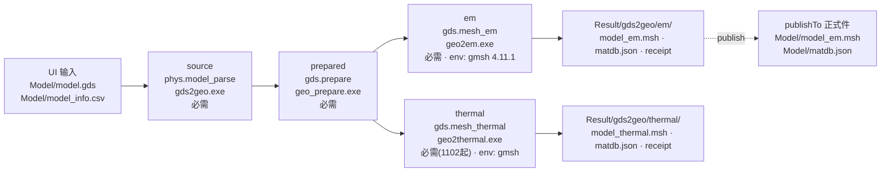
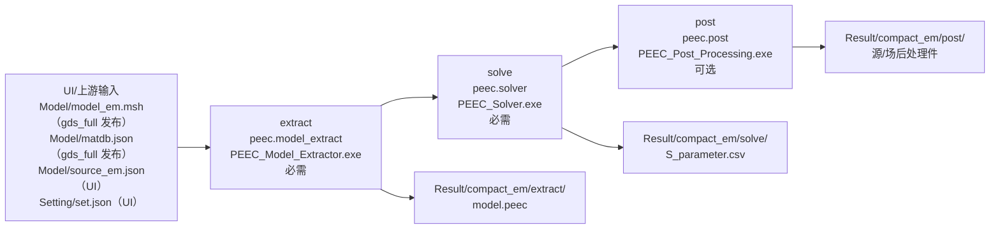
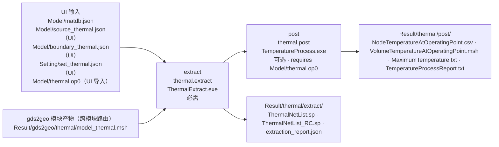
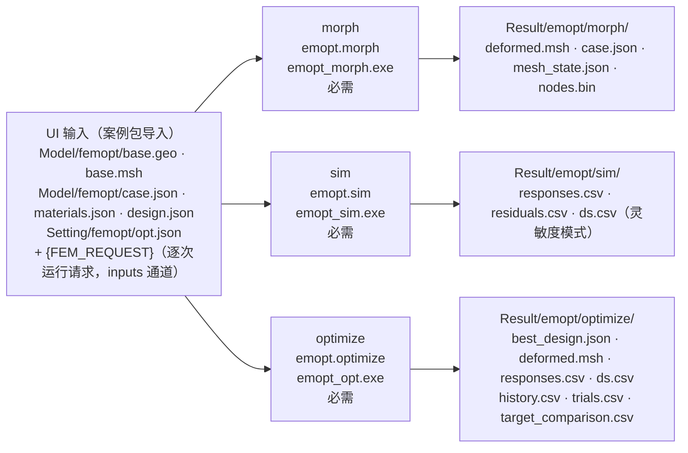

# 平台 Pipeline 示例与模块 Pipeline 填写模板（供应商交接）

> **用途**：交给 DHT 团队（emopt 有限元仿真优化模块）。以平台现有三条流水线（gds_full / peec_basic / thermal_basic）为**格式示例**，绘制本模块接入平台的 pipeline 图：每步 stage 的 exe、输入输出、是否可选、依赖关系。
> 日期：2026-11-05 · 配套文件：`PIPELINE_EXAMPLE_20261105.pptx`（可编辑示例图，本 MD 的图形版）· 关联活契约：`docs/DATA_LAYOUT.md`（v1.5 修订 1）/ `docs/MODULE_MANIFEST_SPEC.md`（v1.2）/ `docs/MODULE_ONBOARDING.md` / `task_layer/README.md`、`task_layer/UI_API.md`。
> 字段事实源（冲突时以配置文件为准）：`task_layer/config/pipelines.json`（流水线 DAG）、`task_layer/config/modules.json`（moduleId → provider/stage 路由）、各包 `module.manifest.json`（CLI/工件/退出码契约）。

---

## 一、平台调度机制速览（画图前置知识）

### 1.1 三层架构与数据流

```
UI（Qt）  ── JSON-RPC 2.0 over stdio ──►  task_layer.exe
                                           输入检查 · 任务编排 · 模块路由 · 状态与结果管理
                                              │  按 pipeline 定义调度（依赖 DAG + 最大并行）
计算层模块（kind=external：直接启动 exe / kind=dll：worker_host 隔离加载）
                                              │
数据层  dataRoot：<dataRoot>\Model\（UI 输入+正式件） · Setting\（设置） · Result\（产物）
```

- 产物流：`Model//Setting/`（UI 写入的输入）→ stage exe 执行 → `Result/<providerId>/<stageId>/`（模块私有产物区）→ **publisher** 按 manifest `publishTo` 复制正式件到 `Model//Setting/`（模块自己不搬文件）；
- 日志/临时件：`--runtime-dir` 落 `Result/logs/<providerId>/`（`{runtimeDir}` 变量 = 该目录）。

### 1.2 pipeline / stage 语义

| 概念 | 说明 |
|---|---|
| pipeline | `pipelines.json` 中的静态 DAG；`maxParallel` 限并发 |
| stage | `{id, module, name, dependsOn[], optional, requires[], artifacts{}, params}`；`id` = `Result/<providerId>/<stageId>/` 目录名 |
| 依赖 | `dependsOn` 上游 stage 全部 Done 才执行；上游 Failed 则本 stage 不执行 |
| 可选 | `optional: true` + `requires: [文件列表]`：**数据驱动自动跳过**——requires 文件缺失 → 状态 Skipped，不阻断主链 |
| 工件路由 | `artifacts: { "<ref>": "<path>" }`：把 manifest consumed 的 ref 路由到指定实际位置（典型：热网格消费 `Result/gds2geo/thermal/model_thermal.msh` 而不是 `Model/`，保持 Model/ 单主网格不变式）；路由优先级：stage artifacts 覆盖 → 本模块 manifest consumed → 本模块 produced → 他模块 produced |
| 单模块执行 | `module.run {moduleId}` = 合成"单阶段流水线"（`single:<moduleId>`），进度/状态/取消与流水线一致 |
| UI 动态输入 | `inputs` 通道：UI 每次运行指定的文件（键名驼峰→大写下划线变量，如 `portJson → {PORT_JSON}`），进 state.json 留痕，`inputs.validate` 做存在性/JSON 合法性浅检 |
| 参数覆盖 | `task.run overrides[stageId]`：白名单 = manifest `allowedArgs`，非法键直接拒绝 |
| 成败判定 | 退出码（manifest `exitCodes` 表归一）+ 浅检 outputCheck（produced 文件存在且非空）+ errorContract（`qs-json-stderr` 时从 stderr 提取最后一条 error/fatal 级 `QS-*` 码透传 UI） |

### 1.3 图例约定（DHT 画图必须遵守）

| 符号 | 含义 |
|---|---|
| 实线框 | 必需 stage |
| 虚线框 | 可选 stage（`optional: true`） |
| 黑色箭头 | `dependsOn`（DAG 依赖方向） |
| 红色粗箭头 | `publishTo`（publisher 落位正式件到 Model//Setting/） |
| 灰色虚线箭头（框内/框间） | 模块内部工件流（`consumesInternal/producesInternal`） |
| 绿色节点 | UI 维护的输入文件（Model//Setting/） |
| 灰色节点 | 数据源（上游模块产物 / 跨模块路由件） |

**每个 stage 框内必须标注**：`stage id`、`moduleId`（provider.stage）、`exe 文件名`、可选性、输入文件（路径）、输出文件（路径）。框外脚注标注：退出码表、errorContract、env 依赖（如 Gmsh 版本）。

---

## 二、示例 1：gds_full（建模与网格，4 stage，含并行分支）

### 2.1 图



`maxParallel=1`；`em` 与 `thermal` 都 `dependsOn: [prepared]`，**并行执行**。

### 2.2 逐 stage 明细

| 字段 | ① source | ② prepared | ③ em | ④ thermal |
|---|---|---|---|---|
| stage id | `source` | `prepared` | `em` | `thermal` |
| moduleId | `phys.model_parse` | `gds.prepare` | `gds.mesh_em` | `gds.mesh_thermal` |
| provider / manifest stage | gds2geo / `source` | gds2geo / `prepared` | gds2geo / `em` | gds2geo / `thermal` |
| exe | `gds2geo.exe` | `geo_prepare.exe` | `geo2em.exe` | `geo2thermal.exe` |
| dependsOn | —（入口） | `source` | `prepared` | `prepared`（与 em 并行） |
| optional | 否 | 否 | 否 | 否（1102 起必需） |
| 输入 | `Model/model.gds`（user/layout.gds）、`Model/model_info.csv`（user/techfile） | `Result/gds2geo/source/`（内部件 source.geo/source.json/source.matdb） | `Result/gds2geo/prepared/`（prepared.em.geo、prepared.em.json、prepared.matdb） | `Result/gds2geo/prepared/`（prepared.thermal.geo、prepared.thermal.json、prepared.matdb） |
| 输出 | `Result/gds2geo/source/`（model.geo、model.json、matdb.json） | `Result/gds2geo/prepared/`（em.geo、em.json、thermal.geo、thermal.json、matdb.json） | `Result/gds2geo/em/`（model_em.msh、matdb.json、model_em.msh.json） | `Result/gds2geo/thermal/`（model_thermal.msh、matdb.json、model_thermal.msh.json） |
| publishTo | — | — | `Model/model_em.msh`（schema 4，单位 mm）、`Model/matdb.json`（schema 3） | — |
| env | — | — | `GDS2GEO_GMSH_EXECUTABLE={MODULE_ROOT}/gds2geo/gmsh.exe` | 同左 |
| 退出码 | 0 ok / 2 input_or_config / 5 execution / 6 internal | 0 / 2 / 5 | 0 / 2 / 5 | 0 / 2 / 5 |
| errorContract | none | none | none | none |

### 2.3 实际命令行（变量展开后）

```
gds2geo.exe --runtime-dir <dataRoot>\Result\logs\gds2geo source --gds <dataRoot>\Model\model.gds --tech <dataRoot>\Model\model_info.csv --output-dir <dataRoot>\Result\gds2geo\source
geo_prepare.exe --runtime-dir <dataRoot>\Result\logs\gds2geo --input-dir <dataRoot>\Result\gds2geo\source --output-dir <dataRoot>\Result\gds2geo\prepared
geo2em.exe --runtime-dir <dataRoot>\Result\logs\gds2geo --input-dir <dataRoot>\Result\gds2geo\prepared --output-dir <dataRoot>\Result\gds2geo\em
geo2thermal.exe --runtime-dir <dataRoot>\Result\logs\gds2geo --input-dir <dataRoot>\Result\gds2geo\prepared --output-dir <dataRoot>\Result\gds2geo\thermal
```

### 2.4 pipelines.json 摘录

```jsonc
"gds_full": {
  "displayName": "建模与网格（GDS2GEO 四阶段）",
  "maxParallel": 1,
  "stages": [
    { "id": "source",    "module": "phys.model_parse", "name": "源模型解析（gds2geo）", "dependsOn": [] },
    { "id": "prepared",  "module": "gds.prepare",      "name": "几何准备",              "dependsOn": ["source"] },
    { "id": "em",        "module": "gds.mesh_em",      "name": "电磁网格",              "dependsOn": ["prepared"] },
    { "id": "thermal",   "module": "gds.mesh_thermal", "name": "热网格（1102 起必需）",  "dependsOn": ["prepared"] }
  ]
}
```

---

## 三、示例 2：peec_basic（电磁基本链路，3 stage，末段可选）

### 3.1 图



`extract.model`（内部件）→ `solve` 消费；`solve.post`（内部件）→ `post` 消费（灰虚线，框间不另画）。
**2026-11-04 起流水线移除 plot 阶段**：S 参数绘图由前端直接读 `Result/compact_em/solve/S_parameter.csv` 完成（manifest 的 plot 阶段条目随 compact_em v1.3 重发版移除）。

### 3.2 逐 stage 明细

| 字段 | ① extract | ② solve | ③ post |
|---|---|---|---|
| stage id | `extract` | `solve` | `post` |
| moduleId | `peec.model_extract` | `peec.solver` | `peec.post` |
| provider / manifest stage | compact_em / `extract` | compact_em / `solve` | compact_em / `post` |
| exe | `PEEC_Model_Extractor.exe` | `PEEC_Solver.exe` | `PEEC_Post_Processing.exe` |
| dependsOn | —（入口） | `extract` | `solve` |
| optional | 否 | 否 | **是** |
| 输入 | `Model/model_em.msh`（ref gds2geo/mesh.em，accept schema 4）、`Model/matdb.json`（ref gds2geo/matdb.model，schema 3）、`Model/source_em.json`（ref em/source.def，字段 meshFile/meshSha256/triangleIds）、`Setting/set.json`（ref user/solver.set；v1.3 起改读 `set_em.json`） | 同左 + 内部件 `compact_em/extract.model` | 同左 + 内部件 `compact_em/solve.post` |
| 输出 | `Result/compact_em/extract/model.peec`（ref compact_em/model.peec，schema 1） | `Result/compact_em/solve/S_parameter.csv`（ref compact_em/sp.csv，schema 1） | `Result/compact_em/post/`（源/场后处理件） |
| publishTo | — | — | — |
| 退出码 | 0 ok / 1 failure / 2 unhandled_exception | 0 / 1 | 0 / 1 |
| errorContract | qs-json-stderr（QS-FMT-*/QS-IO-* 码，trace 落 `Result/logs/compact_em/`） | 同左 | 同左 |

### 3.3 实际命令行（变量展开后）

```
PEEC_Model_Extractor.exe --data-root <dataRoot> --runtime-dir <dataRoot>\Result\logs\compact_em --export post,report
PEEC_Solver.exe          --data-root <dataRoot> --runtime-dir <dataRoot>\Result\logs\compact_em --export post,touchstone
PEEC_Post_Processing.exe --data-root <dataRoot> --runtime-dir <dataRoot>\Result\logs\compact_em --source-plots mag --parts mag
```

### 3.4 pipelines.json 摘录

```jsonc
"peec_basic": {
  "displayName": "电磁基本链路（PEEC 三段）",
  "maxParallel": 1,
  "stages": [
    { "id": "extract", "module": "peec.model_extract", "name": "PEEC 模型提取", "dependsOn": [] },
    { "id": "solve",   "module": "peec.solver",        "name": "频域求解",     "dependsOn": ["extract"] },
    { "id": "post",    "module": "peec.post",          "name": "源/场后处理",  "dependsOn": ["solve"], "optional": true }
  ]
}
```

---

## 四、示例 3：thermal_basic（热基本链路，2 stage，可选 + requires + 跨模块工件路由）

### 4.1 图



**要点**：热网格输入 `user/thermal.mesh` 的规范位置是 `Model/model_thermal.msh`，但 pipeline 用 stage `artifacts` 把它**路由**到 `Result/gds2geo/thermal/model_thermal.msh`（gds_full 的 thermal 阶段产物），保持 Model/ 单主网格不变式 I1。

### 4.2 逐 stage 明细

| 字段 | ① extract | ② post |
|---|---|---|
| stage id | `extract` | `post` |
| moduleId | `thermal.extract` | `thermal.post` |
| provider / manifest stage | thermal / `extract` | thermal / `post` |
| exe | `ThermalExtract.exe` | `TemperatureProcess.exe` |
| dependsOn | —（入口） | `extract` |
| optional | 否 | **是**；`requires: ["Model/thermal.op0"]`（OP0 缺失 → Skipped） |
| 输入 | `Result/gds2geo/thermal/model_thermal.msh`（user/thermal.mesh，经 artifacts 路由）、`Model/matdb.json`（user/thermal.materials，schema 3）、`Model/source_thermal.json`（thermal/source.def，schemaVersion 2，字段 meshFile/meshSha256/sources/thermal）、`Model/boundary_thermal.json`（thermal/boundary.def，schema 1）、`Setting/set_thermal.json`（user/thermal.simulation_settings，schema 1） | 同左 + `Model/thermal.op0`（OP0 工作点）+ 内部件 `thermal/temperature.map`、`thermal/extraction.binding` |
| 输出 | `Result/thermal/extract/`（ThermalNetList.sp、ThermalNetList_RC.sp、extraction_report.json） | `Result/thermal/post/`（NodeTemperatureAtOperatingPoint.csv、VolumeTemperatureAtOperatingPoint.msh、MaximumTemperature.txt、TemperatureProcessReport.txt） |
| publishTo | — | — |
| 退出码 | 0 ok / 2 input_or_configuration / 3 file_io / 4 numerical_validation / 5 runtime_services / 6 pipeline_locked | 同左 |
| errorContract | qs-json-stderr（QS-TH-* 码） | 同左 |

### 4.3 实际命令行（变量展开后）

```
ThermalExtract.exe --data-root <dataRoot> --runtime-dir <dataRoot>\Result\logs\thermal --mesh <dataRoot>\Result\gds2geo\thermal\model_thermal.msh --materials <dataRoot>\Model\matdb.json --source <dataRoot>\Model\source_thermal.json --boundary <dataRoot>\Model\boundary_thermal.json --simulation-settings <dataRoot>\Setting\set_thermal.json
TemperatureProcess.exe --data-root <dataRoot> --runtime-dir <dataRoot>\Result\logs\thermal --mesh <dataRoot>\Result\gds2geo\thermal\model_thermal.msh --materials <dataRoot>\Model\matdb.json --source <dataRoot>\Model\source_thermal.json --op0 <dataRoot>\Model\thermal.op0 --boundary <dataRoot>\Model\boundary_thermal.json --simulation-settings <dataRoot>\Setting\set_thermal.json
```

### 4.4 pipelines.json 摘录

```jsonc
"thermal_basic": {
  "displayName": "热基本链路（thermal 两段）",
  "maxParallel": 1,
  "stages": [
    { "id": "extract", "module": "thermal.extract", "name": "热路提取", "dependsOn": [],
      "artifacts": { "user/thermal.mesh": "Result/gds2geo/thermal/model_thermal.msh" } },
    { "id": "post", "module": "thermal.post", "name": "温度后处理（OP0 映射）", "dependsOn": ["extract"],
      "optional": true,
      "artifacts": { "user/thermal.mesh": "Result/gds2geo/thermal/model_thermal.msh" },
      "requires": ["Model/thermal.op0"] }
  ]
}
```

---

## 五、填写模板（DHT 团队填写后回传）

### 5.1 每个 stage 一张明细卡（复制 N 份）

| 字段 | 填写 | 说明 / 示例 |
|---|---|---|
| stage id | | = `Result/<providerId>/<stageId>/` 目录名，小写 |
| moduleId | | `<provider>.<stage>`，如 `emopt.morph` |
| provider / manifest stage | | 模块包目录名 / manifest stages[].id |
| exe | | 包内可执行文件名（如 `emopt_morph.exe`） |
| dependsOn | | 上游 stage id 列表；`—` = 入口 |
| optional | | 是/否；若是，requires 哪些文件（缺失即 Skipped） |
| requires | | 可选 stage 的数据驱动跳过条件 |
| CLI 命令模板 | | 完整命令行（用 `<dataRoot>` 占位，变量写法同 §2.3） |
| 输入文件 | | 逐行：`ref → 实际路径 → 来源（UI / 上游 publish / 跨模块路由 / 内部件）` |
| 输出文件 | | 逐行：`ref → 实际路径 → schemaVersion → units（可选）→ publishTo（可选）` |
| 退出码表 | | 如 `0 ok / 2 input_or_config / 3 execution` |
| errorContract | | `none` 或 `qs-json-stderr`（后者须给 QS 码域，如 `QS-EMOPT-*`） |
| env 依赖 | | 如 `GMSH_LIBRARY=<path>（Gmsh 4.8）` |
| 耗时量级 | | 单线程参考（供平台/用户预期管理） |

### 5.2 流水线 JSON 骨架（填好 stage 卡后组装）

```jsonc
// task_layer/config/pipelines.json 新增条目（平台方落配置，DHT 提供设计）
"<pipeline_id>": {
  "displayName": "<中文名>",
  "description": "<一句话：阶段链 + 关键约束>",
  "maxParallel": 1,
  "stages": [
    { "id": "<stageId>", "module": "<provider>.<stage>", "name": "<中文名>",
      "dependsOn": [],          // 入口 stage 为空
      "optional": false,        // 可选 stage 置 true
      "requires": [],           // 可选 stage 的跳过条件（文件列表，相对 dataRoot）
      "artifacts": {}           // 需要路由跨模块工件时填写 { "<ref>": "<实际路径>" }
    }
  ]
}
```

### 5.3 modules.json 路由（每 stage 一行，平台方落配置）

```jsonc
"<provider>.<stage>": {
  "displayName": "<中文名>",
  "kind": "external",            // 迁移期 external；目标形态 dll（配 workerHost）
  "provider": "<模块包目录名>",
  "stage": "<manifest stages[].id>",
  "env": {},                     // 需要注入的环境变量（如 Gmsh 库路径）
  "searchDirs": ["{MODULE_ROOT}/<模块包目录名>"]
}
```

### 5.4 交付物与检查清单

| # | 交付物 | 检查 |
|---|---|---|
| 1 | pipeline 图（本 PPT 同格式即可） | 每 stage 框含：id / moduleId / exe / 可选性 / 输入 / 输出；图例符合 §1.3 |
| 2 | stage 明细卡（§5.1，每 stage 一张） | 与图一一对应 |
| 3 | `module.manifest.json` 草案 | 图/卡中每个字段在 manifest 有对应（stages/argsTemplate/allowedArgs/exitCodes/errorContract/consumed/produced/publishTo）；过 `docs/module.manifest.schema.json` 校验 |
| 4 | 案例包 ≥1（包外单独交付） | dataRoot 布局 + README（输入来源/验收点/已知局限） |
| 5 | `ERROR_CODES.md` | 覆盖 exitCodes 表全部失败路径 |
| 6 | `README.md` | 调用方式、全部 CLI 参数与退出码、自测方法、依赖（Gmsh 版本等） |

**一致性红线**：图 = stage 明细卡 = manifest = 实际 CLI 行为，四方一致；数值行为以交付自测报告为基线。

---

## 六、参考：FEM-opt（emopt）预填示例（仅供对照）

> 以下按平台侧接入草案（`docs/plans/EMOPT_INTEGRATION_20261104.md`）预填。**DHT 请独立按 §五模板绘制，再与本子节核对一致性**；有出入处以合同会议（Phase 0）结论为准。

### 6.1 图



**结构要点**：三个模块**相互独立**（各请求自带当前尺寸；`emopt_opt.exe` 内部闭环 morph+sim，无 pipeline 级 DAG 依赖）→ 以 `module.run` 单模块调用为主，**不需要**新增多阶段 pipeline（可选演示 pipeline 除外）。

### 6.2 逐 stage 明细（草案）

| 字段 | morph | sim | optimize |
|---|---|---|---|
| stage id | `morph` | `sim` | `optimize` |
| moduleId | `emopt.morph` | `emopt.sim` | `emopt.optimize` |
| exe | `emopt_morph.exe` | `emopt_sim.exe` | `emopt_opt.exe` |
| dependsOn | — | — | —（三者独立） |
| optional | 否 | 否 | 否 |
| CLI 命令模板 | `emopt_morph.exe <dataRoot>\Model\femopt\design.json {FEM_REQUEST} <dataRoot>\Result\emopt\morph` | `emopt_sim.exe {FEM_REQUEST} <dataRoot>\Result\emopt\sim` | `emopt_opt.exe <dataRoot>\Setting\femopt\opt.json <dataRoot>\Result\emopt\optimize` |
| 输入 | `Model/femopt/design.json`（emopt.design.v2）+ 请求 JSON（emopt.morph.request.v1：parametersMeter/purpose/emitNodeJacobian）+ 请求引用的 `case.json`/`base.geo`/`base.msh`/`materials.json` | 请求 JSON（emopt.module.sim.v2：mode=full_order/fast_s/fast_sensitivity、case、design、parametersMeter） | `Setting/femopt/opt.json`（emopt.module.opt.v2：case/design 绝对引用 + parametersMeter + targets + optimizer） |
| 输出 | `Result/emopt/morph/`：deformed.msh、case.json、materials.json、mesh_state.json、nodes.bin（+directions.bin 按请求）、result.json、module_result.json、run.log | `Result/emopt/sim/`：responses.csv、residuals.csv、result.json、module_result.json、run.log（灵敏度另 ds.csv、projected_tangent_residuals.csv、conditioning.csv） | `Result/emopt/optimize/`：best_design.json、deformed.msh、case.json、responses.csv、ds.csv、history.csv、trials.csv、target_comparison.csv、progress/、result.json、module_result.json、run.log |
| publishTo | —（UI 直读结果；如需把最佳设计回写 Model/ 由 UI 执行） | — | — |
| 退出码 | 0 ok / 2 input_or_config / 3 execution | 同左 | 同左 |
| errorContract | qs-json-stderr（QS-EMOPT-* 域） | 同左 | 同左 |
| env | `EMOPT_GMSH_LIBRARY=<MODULE_ROOT>/emopt/runtime/gmsh-4.8.dll`（Gmsh 4.8 native） | 同左（fast_sensitivity 内部做变形） | 同左 |
| 耗时量级 | ~10 s | fast_s ~40–70 s / fast_sensitivity ~150–175 s | ~15–17 min（10 次评估） |

### 6.3 与现有三条示例的差异点（画图时注意）

| 差异 | 说明 |
|---|---|
| 无 stage 间依赖 | 三条现有 pipeline 均为链式 DAG；FEM-opt 三模块独立（请求文件自包含），图上**不画** stage 间箭头 |
| 逐次运行请求经 inputs 通道 | 现有模块输入全部固定位置；FEM-opt 的 `{FEM_REQUEST}` 是 UI 每次运行生成的动态输入文件（先例 `portJson`） |
| 无 publishTo | FEM-opt 产物供 UI 直读/下一任务引用，不发布正式件到 Model/ |
| 长耗时单阶段 | optimize 单阶段 ~16 min；现有模块均分钟级以内——图脚注标注耗时与"无超时（现状）" |

---

## 七、字段来源对照（图 → 配置 → 代码）

| 图中要素 | 定义处 | 消费处 |
|---|---|---|
| stage 集合/依赖/optional/requires/artifacts | `pipelines.json` | `PipelineLoader`（DAG 三段校验）→ `TaskOrchestrator`（pump 调度） |
| moduleId → provider/stage/exe/env | `modules.json` + 包 `module.manifest.json` | `ModuleRegistry`（路由解析）→ `ModuleRunner`（启动 exe、argsTemplate 展开） |
| argsTemplate 变量 | manifest stages[].argsTemplate | `{dataRoot}` / `{runtimeDir}`（=`Result/logs/<provider>`）/ `{moduleDir}` / `{artifact:<ref>}` / `{override:<key>}` / inputs 变量（如 `{FEM_REQUEST}`） |
| 输入浅检 | manifest artifacts.consumed（required 子集）+ stage requires | `InputValidator`（inputs.validate / 运行前） |
| 输出浅检 | manifest artifacts.produced | `ModuleRunner`（stage.finished 后） |
| publishTo | manifest artifacts.produced[].publishTo | `ModuleRunner` publisher（阶段成功后复制） |
| 退出码归一 | manifest stages[].exitCodes + ERROR_CODES.md | `ModuleRunner`（errorCode 归一/透传） |
| 状态持久化 | — | `ResultStore`：`Result/tasks/<taskId>/state.json`（模块不写不读） |
